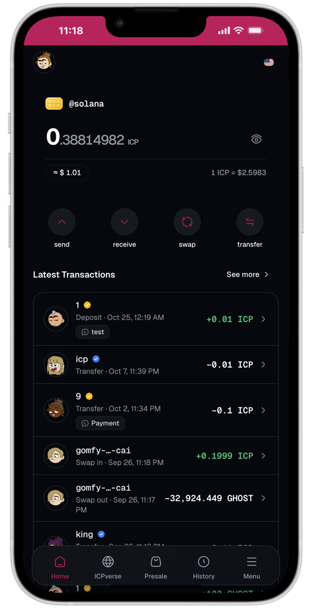
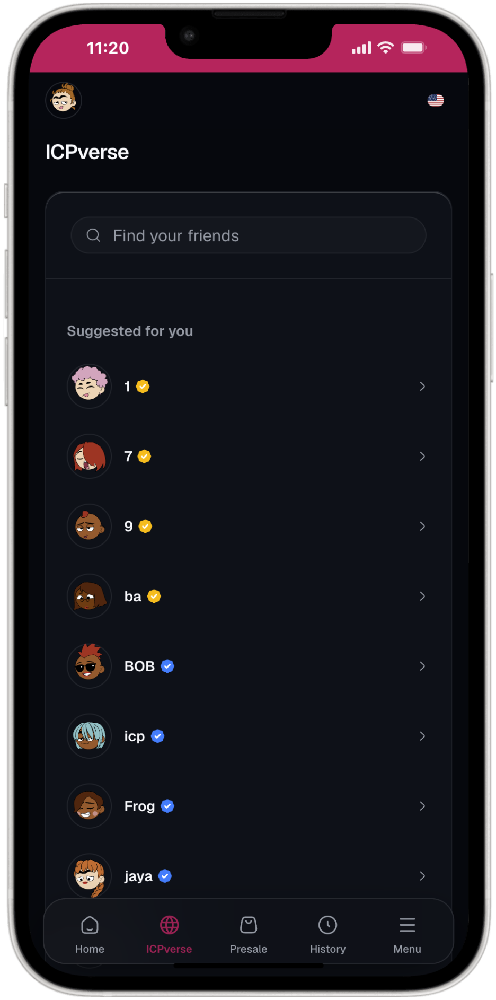
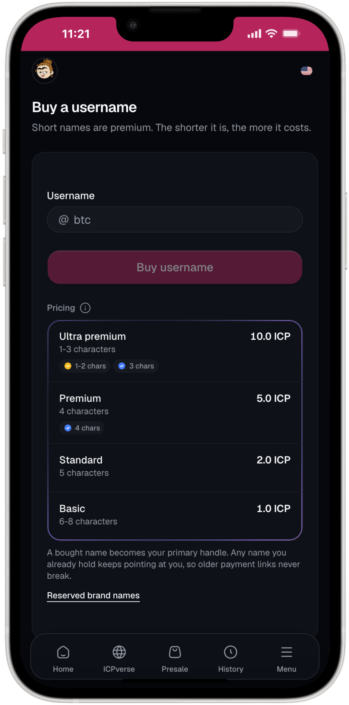

<p align="center">
  
</p>

<h1 align="center">ICPay</h1>

<p align="center">
  <b>Instant username payments, on-chain S3-compatible cloud storage, and native Internet Computer canister management.</b>
</p>

<p align="center">
  <a href="https://github.com/prasangaramanpokharel/ICPay/actions/workflows/ci.yml"></a>
  <a href="https://github.com/prasangaramanpokharel/ICPay/actions/workflows/codeql.yml"></a>
  <a href="https://github.com/prasangaramanpokharel/ICPay/releases"></a>
  <a href="https://internetcomputer.org"></a>
  <a href="LICENSE"></a>
</p>

<p align="center">
  <a href="https://icpay.app"><b>icpay.app (Production)</b></a> ·
  <a href="https://63dke-waaaa-aaaan-q6mvq-cai.icp0.io"><b>On-Chain Canister</b></a> ·
  <a href="https://icpay.app/transparency"><b>Transparency</b></a> ·
  <a href="https://icpay.app/bucket/docs"><b>Documentation</b></a> ·
  <a href="https://www.npmjs.com/package/icpay-bucket"><b>icpay-bucket SDK</b></a>
</p>

---

## Overview

**ICPay** is a decentralized financial and cloud infrastructure portal built 100% on the [Internet Computer](https://internetcomputer.org). You sign in using **Internet Identity** (FaceID, TouchID, YubiKey passkeys) — no passwords, no seed phrases, and no private key handling.

* **Instant Username Payments**: Send and receive ICP / ICRC tokens in 1–2 seconds via simple `@username` handles instead of 63-character principal strings.
* **Merchant Payment Links**: Decentralized checkout gateway (`icpay.app/@merchant?amount=1.5&ref=inv_9842`) with zero gateway fees, privacy protection, and automated `return_url` redirects.
* **icBucket (On-Chain Cloud Storage)**: 100% on-chain, S3-compatible decentralized object storage with fine-grained API keys and zero egress fees.
* **Canister Management**: Live cycles runway monitoring, controller operations, automated Wasm snapshots, and 1-click onboarding for AI coding agents.
* **Global Reach**: Native localization across 17 languages.

---

## Screenshots

<table>
  <tr>
    <td width="50%"></td>
    <td width="50%"></td>
  </tr>
  <tr>
    <td align="center"><b>Wallet Dashboard</b><br>Live balances, instant send/receive, and memo-indexed history.</td>
    <td align="center"><b>Public Handles & Pay Links</b><br>Public payment terminal per handle with verified on-chain routing.</td>
  </tr>
  <tr>
    <td width="50%"></td>
    <td width="50%"></td>
  </tr>
  <tr>
    <td align="center"><b>ICPverse Directory</b><br>Search and discover community handles on-chain.</td>
    <td align="center"><b>Handle Registry</b><br>Claim 5–8 character handles for free, or register premium short names.</td>
  </tr>
</table>

---

## Verified Mainnet Canisters

All operations execute directly against verified canisters on the Internet Computer mainnet:

| Canister | Canister ID | Explorer |
|---|---|---|
| **Backend (Custodial & Service Layer)** | `6vbhm-nqaaa-aaaan-q6muq-cai` | [ICP Dashboard](https://dashboard.internetcomputer.org/canister/6vbhm-nqaaa-aaaan-q6muq-cai) |
| **Frontend (Certified Asset Canister)** | `63dke-waaaa-aaaan-q6mvq-cai` | [ICP Dashboard](https://dashboard.internetcomputer.org/canister/63dke-waaaa-aaaan-q6mvq-cai) |
| **Blob Store (icBucket On-Chain Storage)** | `fly6t-piaaa-aaaan-q6oga-cai` | [ICP Dashboard](https://dashboard.internetcomputer.org/canister/fly6t-piaaa-aaaan-q6oga-cai) |
| **ICP Ledger (Official DFINITY Ledger)** | `ryjl3-tyaaa-aaaaa-aaaba-cai` | [ICP Dashboard](https://dashboard.internetcomputer.org/canister/ryjl3-tyaaa-aaaaa-aaaba-cai) |

---

## Developer Packages & SDKs

| Package | Install | Registry | Description |
|---|---|---|---|
| [`icpay-bucket`](https://www.npmjs.com/package/icpay-bucket) | `npm i icpay-bucket` | [](https://www.npmjs.com/package/icpay-bucket) | Full TypeScript SDK for icBucket on-chain decentralized storage. |
| [`create-icfalcon`](https://www.npmjs.com/package/create-icfalcon) | `npm create icfalcon@latest` | [](https://www.npmjs.com/package/create-icfalcon) | CLI tool to scaffold modern full-stack Internet Computer apps in seconds. |

---

## Custody Model & Transparency

* **Custodial Account Derivation**: ICPay is a custodial wallet. Your funds reside in a subaccount of the backend canister derived deterministically from your authenticated Internet Identity principal.
* **Non-Extractable by Operator**: Fund movement functions in `TransferService.mo` and `WithdrawService.mo` require the authenticated `caller` matching the derived subaccount. No administrative endpoint exists to move user funds.
* **Audit Status**: ICPay has **not been independently audited**. A single controller principal manages upgrades.
* **Full Transparency**: Review the [Transparency Page](https://icpay.app/transparency) for complete on-chain audit parameters and operational boundaries.

---

## Architecture & Layout

```
backend/
├── src/
│   ├── api/v1/         # Thin Candid handlers (delegates caller + parameters)
│   ├── services/       # Core business logic, ledger calls & validation orchestration
│   ├── repositories/   # Data lookup and persistence layers
│   └── storage/        # Stable memory data structures
└── blob_store/         # icBucket on-chain chunked storage canister

frontend/
├── app/                # Next.js App Router (static export with on-chain shell fallback)
├── components/         # Modular feature components & shadcn UI primitives
├── hooks/              # SWR data fetching and canister query hooks
├── services/           # @dfinity/agent actor interfaces and ledger communication
└── public/             # Static certified assets and onchain-shell.js router
```

---

## Bug Reports & Feedback

We welcome bug reports, feature suggestions, and pull requests!

* 🐛 **Found a Bug?** [**Create a Bug Report**](https://github.com/prasangaramanpokharel/ICPay/issues/new?template=bug_report.md&labels=bug)
* 💡 **Have an Idea?** [**Submit a Feature Request**](https://github.com/prasangaramanpokharel/ICPay/issues/new?template=feature_request.md&labels=enhancement)
* 💬 **Questions or General Support?** [**Contact Us**](https://icpay.app/contact) or open an issue.

---

## Security Policy & Vulnerability Disclosure

Security is our highest priority. If you discover a security vulnerability or exploit:

👉 **Please report it privately via [GitHub Security Advisories](https://github.com/prasangaramanpokharel/ICPay/security/advisories/new).**

Do **NOT** report critical security vulnerabilities in public issues. Reports submitted through our private advisory channel remain encrypted and confidential until an authorized patch is tested and deployed. 

Review our full [SECURITY.md](SECURITY.md) for scope and disclosure timelines.

---

## Contributing

Please review [CONTRIBUTING.md](CONTRIBUTING.md) before submitting code. All contributions must pass static verification (`npm run ci backend:test` and `npm run ci:verify`).

---

## License

This project is licensed under the [MIT License](LICENSE).
