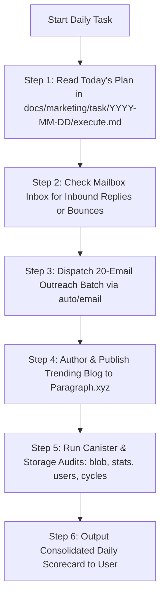

# ICPay Daily Operations & Marketing Playbook (AI Standard Operating Procedure)

This guide documents the exact daily routine, commands, and rules for executing ICPay's marketing, content syndication, agency outreach, and on-chain canister operations. Any AI agent or developer taking over can follow this playbook step-by-step to complete daily tasks.

---

## 1. Non-Negotiable Rules & Invariants

1. **Authentication & Keys**: Authentication is Internet Identity only. **Never store, request, or commit private keys, seed phrases, `.pem` files, or passwords.**
2. **Pinned Derivation Origin**: `NEXT_PUBLIC_DERIVATION_ORIGIN` is permanently pinned to:
   ```
   https://63dke-waaaa-aaaan-q6mvq-cai.icp0.io
   ```
   *Never alter this value.* Doing so invalidates all user identity principals and locks their funds/buckets forever.
3. **No Dev Servers**: **Do NOT run** `npm run dev`, `next dev`, or `dfx start`. Verify all work statically using `npm run ci` or `tsc --noEmit`.
4. **Email Throttling**: The cold outreach runner must always maintain a strict **60-second anti-spam delay** between sends.
5. **Zero Image Duplication**: Every published blog post must use unique, high-resolution stock photos recorded in `auto/blog/data/published_history.json`. Never reuse a photo ID.
6. **Live Publishing**: All articles must be published live (`status: "published"`), never left in draft.
7. **Git Hygiene**: When creating new files in `docs/`, remember that `docs/*` is gitignored and requires explicit negation rules in `.gitignore`.

---

## 2. Daily Routine Checklist (Execute in Order)



---

## 3. Step-by-Step Instructions

### Step 1: Read the Daily Execution Plan
Check the plan for today's date:
```bash
cat docs/marketing/task/$(date +%Y-%m-%d)/execute.md
```
*(If the folder does not exist yet, read the previous day's file and align on the daily sprint focus).*

---

### Step 2: Check Mailbox Inbox & Triage Bounces
Before sending new emails, check the connected Hostinger mailbox (`alert@icpay.cloud`) for human replies or delivery failures:
```bash
npm --prefix auto/email run inbox
```
- **If an email bounced (e.g. `550 NoSuchUser`):**
  Read the failure details:
  ```bash
  npx tsx auto/email/check-inbox.ts --uid <UID>
  ```
  Immediately suppress the invalid address to preserve domain deliverability:
  ```bash
  npx tsx auto/email/audit.ts suppress <bounced-email@domain.com> "NoSuchUser bounce"
  ```

---

### Step 3: Launch Agency Outreach (20 Agencies)
Run the throttled batch sender to contact the next 20 eligible agencies from `docs/marketing/agencies.csv`:

*Preview first (optional):*
```bash
npx tsx auto/email/send-batch.ts --size 20 --template 2 --dry-run
```

*Live Dispatch (runs with 60s sleep between sends):*
```bash
npm --prefix auto/email run send:batch:20
```
- Template 2 (`auto/email/templates/marketing_2.html`) pitches decentralized, zero-egress S3 cloud storage.
- All sends are logged automatically in `auto/email/data/audit_log.json` and `auto/email/data/outreach_audit_report.csv`.
- Verify the audit log anytime:
  ```bash
  npm --prefix auto/email run audit
  ```

---

### Step 4: Author & Publish Trending Blog Post
Publishing an article requires creating a dedicated Markdown file in `auto/blog/posts/` and using the single-post publishing runner.

1. **Create the Markdown file** (`auto/blog/posts/<slug>.md`):
   ```markdown
   ---
   title: "Your Deep-Dive Headline Here"
   subtitle: "Technical, compelling summary explaining why on-chain storage beats centralized cloud."
   tags: ["cloud-storage", "aws-s3", "web3", "serverless"]
   slug: "your-descriptive-slug-2026"
   ---

   [Full article content here with headers, benchmarks, tables, and code snippets]
   ```
2. **Publish to Paragraph.xyz**:
   ```bash
   npx tsx auto/blog/publish-single.ts auto/blog/posts/<slug>.md
   ```
   - Automatically queries the Pexels API for 3 fresh stock photos matching the article's topic keywords.
   - Automatically filters out all previously used photo IDs and URLs to guarantee zero duplication.
   - Publishes live to publication `@incpractical`.
   - Records the slug, title, and images in `auto/blog/data/published_history.json`.

---

### Step 5: Run Platform & On-Chain Canister Audits
Execute the 5 core mainnet audit commands to verify network health, cycle runways, and user adoption:

1. **Blob Storage Audit (icBucket Data Plane):**
   ```bash
   npm run ci blob:audit
   ```
   *Reports: Total physical files stored, megabytes consumed, free capacity (out of 372.5 GB single-canister ceiling), cycles balance, and sharding health.*

2. **Bucket Statistics (Control Plane):**
   ```bash
   npm run ci bucket:stats
   ```
   *Reports: Active buckets, expired buckets, memory usage, and idle burn rate.*

3. **Registered Sovereign Usernames:**
   ```bash
   npm run ci users:count
   ```
   *Reports: Cumulative count of sovereign `@handles` registered on mainnet.*

4. **Canister Cycles Runway:**
   ```bash
   npm run ci cycles:balance
   ```
   *Reports: Balance, daily idle burn, and days of runway for all 8 mainnet canisters.*
   *(Note: If the `index` canister drops below 30 days, top it up with `npm run ci cycles:topup 1000000000000 icpay_index`).*

---

### Step 6: Output Daily Scorecard to User
Present a structured markdown summary to the user with:
- **Live Article:** Title, live URL (`https://paragraph.com/@incpractical/...`), and cumulative article count.
- **Agency Outreach:** Number of emails sent in the current batch, total reached to date, delivery status, and any suppressed bounces.
- **Audit Table:** Active buckets, physical storage headroom, registered usernames (+net new today), and canister cycles runway.

---

## 4. Key Configuration & Canister Reference

| Canister Name | Canister ID | Description |
|---|---|---|
| `icp_wallet_backend` | `6vbhm-nqaaa-aaaan-q6muq-cai` | Main custodial backend & control plane |
| `icp_blob_store` | `fly6t-piaaa-aaaan-q6oga-cai` | S3-compatible chunked binary storage (Data plane) |
| `icpay_notifier` | `2hvuh-xiaaa-aaaan-q6uua-cai` | 24h autonomous lifecycle daemon & email notifier |
| `frontend` | `63dke-waaaa-aaaan-q6mvq-cai` | IC boundary asset canister |
| `trade` | `gomfy-saaaa-aaaan-q6onq-cai` | Decentralized exchange microservice |
| `cns` | `6jtj7-4qaaa-aaaan-q6tta-cai` | Canister Name Service & domain registry |
| `academy` | `wkdfn-yqaaa-aaaan-q6vyq-cai` | Educational on-chain academy portal |
| `icpay_index` | `geode-2qaaa-aaaan-q6wuq-cai` | Global transaction and state index |

* **Hostinger Outbound Email:** `alert@icpay.cloud`
* **Paragraph Publication:** [`@incpractical`](https://paragraph.com/@incpractical)
* **Production WebApp:** [`https://icpay.app`](https://icpay.app)
* **S3 CDN Gateway:** [`https://cdn.icpay.app`](https://cdn.icpay.app)
