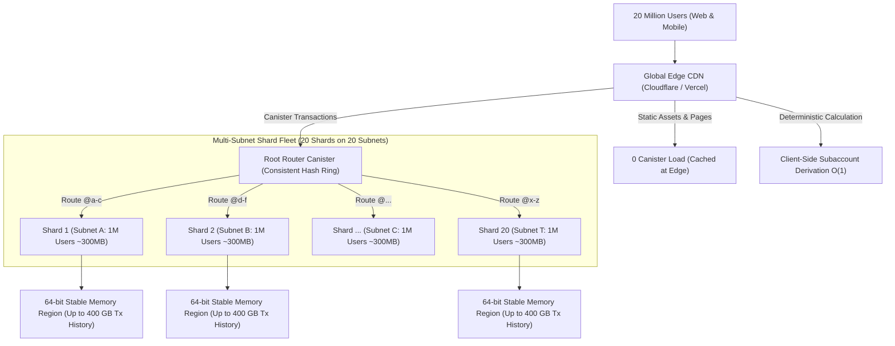

# ICPay Hyper-Scale Architecture Blueprint: 20 Million Users

This document defines the architectural scaling roadmap for ICPay to expand from the current single-canister custodial foundation to a high-throughput, multi-canister sharded ecosystem supporting **20,000,000 (20 Million) users** on the Internet Computer.

---

## 1. Executive Summary & Physical Constraints

At **20 Million users**, a single canister reaches hard physical and computational ceilings of the 32-bit WebAssembly architecture and single-subnet execution bounds:

| Metric | Per User / Tx | Total at 20 Million Users | Physical Ceiling Hit |
|---|---|---|---|
| **User State** (Profile, handle, subaccount) | ~300 bytes | **~6.0 GB** | ❌ **Exceeds single canister 4.0 GB Wasm heap limit**. |
| **Transaction History** (5 txs / user avg) | ~150 bytes | **~15.0 GB** (100M txs) | ❌ Cannot fit inside a single canister heap. |
| **Throughput (Peak Traffic Spikes)** | — | **5,000–10,000 msgs/sec** | ❌ Exceeds single subnet limit (~750 update calls/sec). |
| **Frontend CDN Traffic** | — | **Zero bottleneck** | ✅ Static export on Cloudflare/Vercel handles unlimited edge traffic. |

---

## 2. Architecture: Single Canister vs. Sharded Fleet

---

## 3. Four Core Pillars to Scale to 20 Million Users

### Pillar 1: Horizontal Canister Sharding (Fleet Model)
* Instead of storing 20 million users on one canister, deploy a **fleet of Shard Canisters** (e.g., 20 shards, each managing 1,000,000 users).
* **Shard Size**:
  $$\text{1,000,000 users} \times 300\text{ bytes} \approx 300\text{ MB per shard}$$
  Each shard consumes less than 10% of the 4 GB Wasm heap, leaving 3.7 GB of safety headroom per canister.
* **Router Canister**: A lightweight Root Router canister maps handles to shard IDs using consistent hashing or a distributed directory.

### Pillar 2: 64-bit Stable Memory (`Region` up to 400 GB)
* Move historical transaction logs and activity receipts off the Wasm heap into **Motoko 64-bit Stable Memory (`Region`)**.
* Single canister stable memory capacity is **400 GiB** (and up to 2 TiB on enterprise subnets). 
* 100 million transaction receipts (~15 GB) easily fit inside stable memory without triggering garbage collection pauses or Wasm 32-bit heap exhaustion.

### Pillar 3: Multi-Subnet Workload Distribution
* By distributing the 20 shard canisters across **different IC application subnets**, total system throughput scales linearly:
  $$\text{20 Subnets} \times 750\text{ msgs/sec} = \mathbf{15,000\text{ update transactions per second}}$$
* Cross-shard payments leverage the Internet Computer’s native asynchronous consensus messaging without centralized bridges.

### Pillar 4: Zero-RPC Client-Side Determinism
* **Deterministic Subaccount Derivation**: In ICPay, subaccounts are mathematically derived from the caller's Internet Identity Principal:
  $$\text{Subaccount} = \text{SHA224}(\text{caller}) + \text{checksum}$$
* The client computes this locally in TypeScript/Wasm in **0.01 ms**. Users can receive transfers, view their deposit addresses, and share payment links before their profile record is ever fetched from a canister.

---

## 4. Phased Scale Progression

| Scale Tier | User Count | Architectural State |
|---|---|---|
| **Tier 1 (Current)** | 0 – 100,000 | Single Canister (`icp_wallet_backend`), TrieMap memory indexes, Next.js static export edge caching. |
| **Tier 2 (Phase 7)** | 100,000 – 1,000,000 | Single Canister + 64-bit Stable Memory (`Region`) offloading for transaction logs; NNS/SNS decentralized custody. |
| **Tier 3 (Enterprise)** | 1,000,000 – 20,000,000+ | Multi-Canister Shard Fleet across 20+ Subnets, Root Router Canister, horizontal ledger partitioning. |
