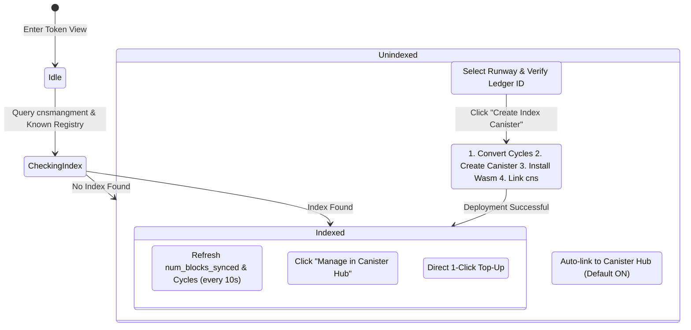

# Architecture and API Plan: One-Click Token Indexing with Canister Management Integration

## 1. Executive Summary

This specification outlines the architecture, data models, API endpoints, cycle economics, and user interface for adding a **One-Click Token Indexing** feature to ICPay.

The feature enables token creators and users to:
1. Deploy an official ICRC-1/ICRC-2 Next-Gen Index Canister (`ic-icrc1-index-ng`) for any token with a single action.
2. Monitor index health metrics in real time: block synchronization status, cycle balance, daily idle burn, and remaining runway.
3. Automatically register the newly provisioned Index Canister into ICPay's existing **Canister Management Hub** (`cnsmangment` / `/canister`) via an "Auto-Link" toggle, creating a unified operational experience across Token Launch and Canister Operations without fracturing system state.

In accordance with `.claude/skills/icpay-integration/SKILL.md`, this design guarantees **zero overhead and zero liability** for the custodial wallet backend (`icp_wallet_backend` / `6vbhm-nqaaa-aaaan-q6muq-cai`).

---

## 2. Architectural Blueprint & System Load Analysis

### 2.1 Architectural Invariants
* **Custodial Isolation**: The core wallet canister custodies user ICP and must never host Wasm blobs, pay for user canister creations, or store third-party indexing state.
* **Controller Sovereignty**: The user's Internet Identity caller principal is set as the sole initial controller of the deployed Index Canister. ICPay never holds custody over user-deployed index canisters.
* **Leverage Existing Infrastructure**:
  * Canister creation and cycles conversion utilize the official Cycles Minting Canister (CMC: `rkp4c-7iaaa-aaaaa-aaaca-cai`).
  * Index Wasm payload is streamed from `icp_blob_store` (`fly6t-piaaa-aaaan-q6oga-cai`) or client asset distribution, preventing canister heap bloat.
  * Canister linking and cycle tracking utilize the existing Rust microservice `cnsmangment` (`6jtj7-4qaaa-aaaan-q6tta-cai`).

```
┌────────────────────────────────────────────────────────────────────────┐
│                              Browser Client                             │
│                                                                        │
│  ┌───────────────────────┐             ┌────────────────────────────┐  │
│  │   Token Index Tab     │             │  Canister Management Hub   │  │
│  │  (Launch/Token View)  │◄───────────►│       (/canister)          │  │
│  └───────────┬───────────┘             └─────────────┬──────────────┘  │
└──────────────┼───────────────────────────────────────┼─────────────────┘
               │                                       │
    1. Convert ICP -> Cycles                4. Link Canister
       & Create Canister                       (if Auto-link enabled)
               ▼                                       ▼
    ┌──────────────────────┐                 ┌────────────────────┐
    │   CMC / Management   │                 │    cnsmangment     │
    │  Canister (Mainnet)  │                 │    Rust Canister   │
    └──────────┬───────────┘                 └────────────────────┘
               │
    2. Install index wasm
       with (Init ledger_id)
               ▼
    ┌──────────────────────┐
    │     icpay_index      │ ◄─── 3. Continuously syncs blocks
    │   (Index Canister)   │      from Token Ledger Canister
    └──────────────────────┘
```

### 2.2 System Load Comparison

| Architecture Model | Load on ICPay Backend | Cycle Liability | Operational Complexity | Recommendation |
|---|---|---|---|---|
| **Model A: Monolithic Backend Deployment** | High (memory & heap risk) | ICPay pays creation fees (High risk) | High | Rejected (violates custody model) |
| **Model B: Client-Orchestrated Factory** | Zero | Zero (User converts own ICP via CMC) | Low | **Recommended (Phase 1)** |
| **Model C: Dedicated Rust Indexer Factory** | Zero (isolated micro-canister) | User deposits ICP/cycles upfront | Medium | Phase 2 (for batch/enterprise) |

**Decision**: Model B (Client-Orchestrated Factory) is selected. It reuses existing, battle-tested services (`frontend/services/canister/createCanister.ts` and `frontend/services/canister/cnsClient.ts`), incurs **zero operational cycle liability for ICPay**, and provides instant real-time feedback in the UI.

---

## 3. Endpoints & Candid Interfaces

### 3.1 Canister Management Integration (`cnsmangment`)

When "Auto-link to Canister Management" is toggled on, the client invokes `link_canister` on `cnsmangment` (`6jtj7-4qaaa-aaaan-q6tta-cai`).

#### Candid Service Interface:
```candid
type LinkedCanister = record {
  canister_id : principal;
  name : text;
  description : opt text;
  linked_at : nat64;
  updated_at : nat64;
};

type LinkCanisterArgs = record {
  canister_id : principal;
  name : text;
  description : opt text;
};

type ResultRecord = variant {
  Ok : LinkedCanister;
  Err : text;
};

service : {
  link_canister : (LinkCanisterArgs) -> (ResultRecord);
  get_linked_canisters : () -> (vec LinkedCanister) query;
  unlink_canister : (principal) -> (variant { Ok; Err : text });
  update_canister_name : (principal, text) -> (variant { Ok; Err : text });
}
```

#### Client Request Payload:
```typescript
const linkArgs = {
  canister_id: Principal.fromText(indexCanisterId),
  name: `${tokenSymbol} Index`,
  description: [`Index canister for ${tokenName} (${ledgerCanisterId})`],
}
```

---

### 3.2 Index Canister Initialization Endpoint (`ic-icrc1-index-ng`)

During deployment, the Wasm module is initialized with the `Init` variant pointing directly to the target ledger.

#### Candid Service Interface:
```candid
type InitArg = record {
  ledger_id : principal;
  retrieve_blocks_from_ledger_interval_seconds : opt nat64;
  min_retrieve_blocks_from_ledger_interval_seconds : opt nat64;
  max_retrieve_blocks_from_ledger_interval_seconds : opt nat64;
};

type UpgradeArg = record {
  ledger_id : opt principal;
  retrieve_blocks_from_ledger_interval_seconds : opt nat64;
  min_retrieve_blocks_from_ledger_interval_seconds : opt nat64;
  max_retrieve_blocks_from_ledger_interval_seconds : opt nat64;
};

type IndexArg = variant {
  Init : InitArg;
  Upgrade : UpgradeArg;
};

type Status = record {
  num_blocks_synced : nat;
};

service : (opt IndexArg) -> {
  ledger_id : () -> (principal) query;
  status : () -> (Status) query;
  get_blocks : (record { start : nat; length : nat }) -> (record { blocks : vec variant { Map : vec record { text; variant { Text : text; Nat : nat; Nat64 : nat64; Blob : blob } } }; chain_length : nat64 }) query;
  get_account_transactions : (record { account : record { owner : principal; subaccount : opt blob }; max_results : nat }) -> (variant { Ok : record { balance : nat; transactions : vec record { ... }; oldest_tx_id : opt nat }; Err : text }) query;
}
```

---

### 3.3 IC Management Canister Status (`aaaaa-aa`)

To display cycle balance, memory consumption, and daily idle burn rate in the UI, the frontend queries `canister_status` using the user's controller credentials:

#### Request:
```typescript
const status = await managementCanister.canister_status({
  canister_id: Principal.fromText(indexCanisterId),
})
```

#### Metrics Returned:
* `status.cycles`: Current cycle balance (e.g., `426_106_034_330n`).
* `status.idle_cycles_burned_per_day`: Daily idle burn (e.g., `2_038_754_537n`).
* `status.memory_size`: Memory footprint in bytes (e.g., `45_982_177n`).
* `status.settings.controllers`: Confirms operator identity is controller.

---

## 4. Cycle Economics & Cost Calculator for Users

The frontend presents a transparent cost estimator before the user confirms creation.

### 4.1 Cost Breakdown Formula

$$\text{Total ICP Required} = \frac{\text{Required Cycles}}{\text{Cycles Per ICP (from CMC)}} + \text{Transaction Fees}$$

Where:
* **Subnet Creation Fee**: `500,000,000,000 cycles` (0.50 TC fixed).
* **Wasm Execution & Install Headroom**: `30,000,000,000 cycles` (0.03 TC).
* **Initial Operating Balance**: User-selectable buffer:
  * *Economy (60 days runway)*: `150,000,000,000 cycles` (0.15 TC). Total: **0.68 TC** (~0.28 ICP).
  * *Standard (180 days runway)*: `370,000,000,000 cycles` (0.37 TC). Total: **0.90 TC** (~0.36 ICP).
  * *Production (365 days runway)*: `750,000,000,000 cycles` (0.75 TC). Total: **1.28 TC** (~0.51 ICP).

### 4.2 Dynamic Runway Calculation

$$\text{Runway (Days)} = \frac{\text{Canister Cycles Balance} - \text{30-Day Freezing Reserve}}{\text{Idle Cycles Burned Per Day}}$$

* With typical memory under 50 MB, the daily burn rate stabilizes at $\approx 2.04\times 10^9\text{ cycles/day}$.
* Every `0.1 TC` (`100B cycles`) of top-up provides $\approx 49\text{ days}$ of autonomous runway.

---

## 5. Frontend Architecture & Component Blueprint

### 5.1 Directory Organization

Following ICPay folder-first conventions:

```
frontend/
├── services/
│   └── index/
│       ├── client.ts             # Index canister actor calls (status, sync, blocks)
│       ├── deploy.ts             # Orchestrates CMC create + wasm install
│       ├── types.ts              # Data models and status view interfaces
│       └── constants.ts          # Upstream wasm URL, commit hash, candid
├── hooks/
│   └── useTokenIndex.ts          # SWR hook for polling sync & cycles status
└── components/
    └── index/
        ├── token-index-tab.tsx       # Main tab wrapper in Token view
        ├── deploy-index-card.tsx     # Wizard: ledger input, runway slider, auto-link toggle
        ├── index-metrics-card.tsx    # Live dashboard: cycles, burn rate, runway, sync
        └── index-actions-card.tsx    # Quick actions: top-up cycles, view in Canister Hub
```

---

### 5.2 Component Behavior & State Transition



---

### 5.3 UI Specification (`token-index-tab.tsx`)

Strict adherence to ICPay UI rules: Existing `@/components/ui/*` primitives, semantic color tokens, Hugeicons only, zero comments in UI code.

#### Visual Elements:
1. **Unindexed State**:
   * Header: "Token Transaction Indexer" with `CardTitle` and `CardDescription`.
   * Ledger Input: Pre-filled with active token ledger ID, disabled or validated against IC principals.
   * Runway Selector: Three options (60 days, 180 days, 365 days) mapped to estimated ICP cost.
   * Auto-link Switch: `Switch` component with label:
     `"Auto-link to Canister Management"`
     Subtext: `"Enables one-click cycle top-ups, controller management, and snapshots in /canister"`.
   * Action Button: `<Button variant="default" className="w-full">Deploy Index Canister</Button>`.

2. **Indexed / Active State**:
   * Status Banner: `<Badge variant="outline" className="bg-success/10 text-success border-success/20">Active & Syncing</Badge>`.
   * Metric Grid (4 Cards):
     * **Blocks Indexed**: `${num_blocks_synced} / ${ledger_chain_length}` with progress indicator.
     * **Cycle Balance**: `${formatCycles(cycles)}` with status badge (Healthy / Low).
     * **Burn Rate**: `${formatCycles(idleBurn)} / day`.
     * **Runway**: `${runwayDays} days remaining`.
   * Action Row:
     * `<Button variant="outline">Manage in Canister Hub <HugeiconsIcon icon={ArrowRight01Icon} /></Button>` (Deep links to `/canister?id=${indexCanisterId}`).
     * `<Button variant="secondary">Top Up Cycles</Button>` (Opens ICPay standard top-up modal).
     * `<Button variant="ghost">Copy Canister ID</Button>`.

---

## 6. Detailed Implementation Sequence & Code Samples

### 6.1 Deployment Orchestrator (`services/index/deploy.ts`)

```typescript
import { Principal } from "@icp-sdk/core/principal"
import type { Identity } from "@icp-sdk/core/agent"
import { createCanisterWithCycles } from "@/services/canister/createCanister"
import { linkCanister } from "@/services/canister/cnsClient"
import { installIndexWasm } from "@/services/index/client"

export type DeployIndexRequest = {
  identity: Identity
  ledgerCanisterId: string
  tokenName: string
  tokenSymbol: string
  amountE8s: bigint
  autoLink: boolean
}

export type DeployIndexResult = {
  indexCanisterId: string
  numBlocksSynced: bigint
  linkedInCns: boolean
}

export async function deployTokenIndex(
  request: DeployIndexRequest
): Promise<DeployIndexResult> {
  const { identity, ledgerCanisterId, tokenName, tokenSymbol, amountE8s, autoLink } = request

  // Step 1: Create Canister via CMC using user's ICP
  const creation = await createCanisterWithCycles(identity, {
    amountE8s,
    extraControllers: [identity.getPrincipal().toText()],
  })

  const indexCanisterId = creation.canisterId

  // Step 2: Install Index Wasm with target ledger argument
  await installIndexWasm(identity, {
    canisterId: indexCanisterId,
    ledgerPrincipal: Principal.fromText(ledgerCanisterId),
  })

  // Step 3: Auto-link to Canister Management Hub if enabled
  let linkedInCns = false
  if (autoLink) {
    try {
      const linkRes = await linkCanister(identity, {
        canister_id: Principal.fromText(indexCanisterId),
        name: `${tokenSymbol} Index`,
        description: [`ICRC Index Canister for ${tokenName}`],
      })
      linkedInCns = "Ok" in linkRes
    } catch {
      linkedInCns = false
    }
  }

  return {
    indexCanisterId,
    numBlocksSynced: 0n,
    linkedInCns,
  }
}
```

---

### 6.2 Real-time Sync and Runway Polling (`services/index/client.ts`)

```typescript
import { Actor, type Identity } from "@icp-sdk/core/agent"
import { Principal } from "@icp-sdk/core/principal"
import { createAgent } from "@/services/icp"

export type IndexStatusSnapshot = {
  ledgerId: string
  numBlocksSynced: bigint
  chainLength: bigint
  isFullySynced: boolean
}

export async function fetchIndexStatus(
  identity: Identity | undefined,
  indexCanisterId: string,
  ledgerCanisterId: string
): Promise<IndexStatusSnapshot> {
  const agent = await createAgent(identity)
  
  // 1. Query Index Canister
  const indexActor = Actor.createActor(INDEX_IDL, {
    agent,
    canisterId: Principal.fromText(indexCanisterId),
  })
  const statusRes = (await indexActor.status()) as { num_blocks_synced: bigint }
  const ledgerIdRes = (await indexActor.ledger_id()) as Principal

  // 2. Query Ledger Canister Tip
  const ledgerActor = Actor.createActor(LEDGER_IDL, {
    agent,
    canisterId: Principal.fromText(ledgerCanisterId),
  })
  const blocksRes = (await ledgerActor.get_blocks({ start: 0n, length: 1n })) as {
    chain_length: bigint
  }

  const numBlocksSynced = statusRes.num_blocks_synced
  const chainLength = blocksRes.chain_length

  return {
    ledgerId: ledgerIdRes.toText(),
    numBlocksSynced,
    chainLength,
    isFullySynced: numBlocksSynced >= chainLength,
  }
}
```

---

## 7. Security, Invariants & Error Recovery Runbook

### 7.1 Security & Custody Rules
1. **Never pass caller principal as argument**: All actions authenticate caller implicitly through `@dfinity/agent`.
2. **Never store keys or seeds**: Only Internet Identity sessions sign canister calls.
3. **Controller Guard**: The user identity MUST be assigned as the primary controller. If ICPay introduces automated upgrades, ICPay controller principal may be appended to `extraControllers` only with explicit user opt-in.

### 7.2 Failure Modes & Resilience Matrix

| Failure Mode | Point of Failure | Client Recovery Mechanism |
|---|---|---|
| **Insufficient ICP Balance** | Step 1 (CMC) | Pre-validation check against user's ICP ledger balance; displays exact shortfall before initiating transaction. |
| **Canister Created, Wasm Install Interrupted** | Step 2 (Install) | Canister ID is already recorded in local storage. UI displays "Complete Installation" button without re-charging the 0.5 TC creation fee. |
| **`cnsmangment` Link Times Out** | Step 3 (Linking) | Canister is already functional and running. UI shows "Link to Hub" button allowing manual retry with zero risk. |
| **Ledger Incompatible / Wrong Principal** | Step 2 (Init) | Index traps if principal does not implement ICRC-1. Client validates ledger standard via `icrc1_supported_standards` prior to initiating creation. |

---

## 8. Verification & Delivery Checklist

Before merging this feature into `main`:

- [ ] **Static Verification**:
  ```bash
  cd frontend
  ./node_modules/.bin/tsc --noEmit
  ./node_modules/.bin/eslint services hooks components app lib --ext .ts,.tsx
  npm run build
  ```
- [ ] **Lint Baseline Preservation**: Enforce ESLint error count $\le 5$ as required by `skills/icpay-frontend/SKILL.md`.
- [ ] **Cycle Balance Test**: Verify `npm run ci cycles:balance` correctly computes and surfaces the index canister along with remaining runway days.
- [ ] **Canister Hub Parity**: Verify that linking the index canister displays it in both `/canister` table and the Token Launch index tab with matching real-time cycle telemetry.
