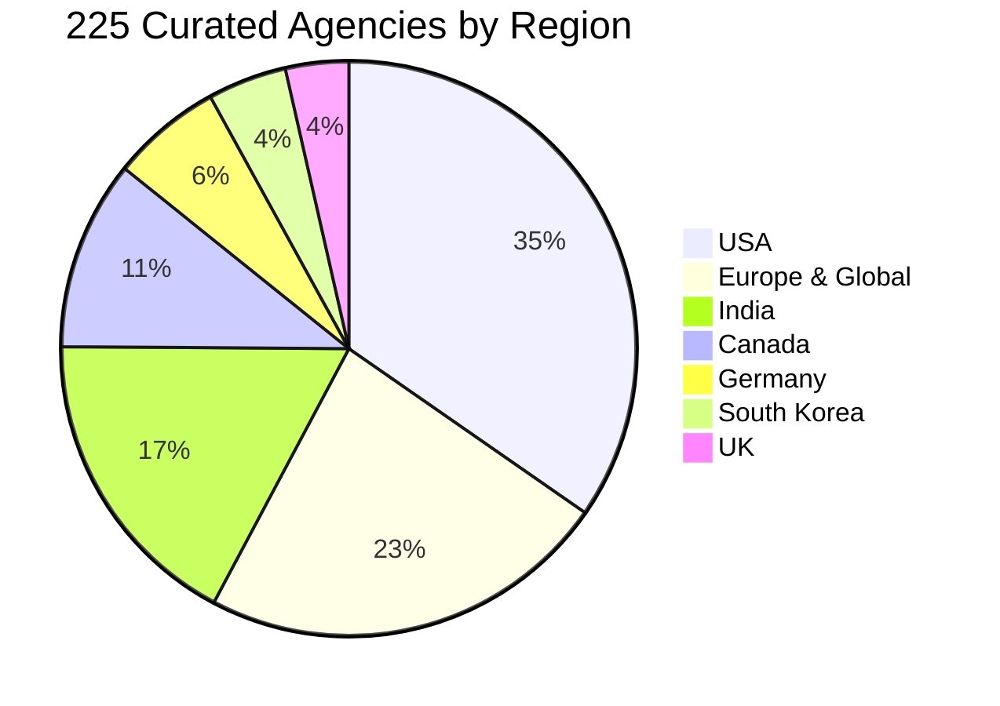

# ICPay Master Agency Directory & Outreach Pipeline (225 Verified Agencies)

**Document ID:** `docs/marketing/agency-directory.md`  
**CSV File:** [`docs/marketing/agencies.csv`](./agencies.csv) (225 Rows, RFC 4180 compliant)  
**Total Curated Agencies:** 225 Verified Agencies across USA, Canada, South Korea, Germany, UK, India, and Global.  
**Last Verified:** October 2026  

---

## 1. Directory Breakdown by Geography & Segment



### A. NFT Studios, Generative Engines & Web3 Creative Platforms
Top global NFT infrastructure, generative minting engines, and Web3 creative studios:
- **Manifold** (`wilkins@manifold.xyz`) — Wilkins Chung (Co-Founder & CTO), Vancouver Canada / SF USA (Creator smart contracts, dynamic minting engines, and decentralized metadata asset storage)
- **Transient Labs** (`team@transientlabs.xyz`) — Marco Peyfuss (Co-Founder & CEO), Denver USA (Dynamic on-chain smart contracts, storytelling metadata engines, and zero-egress digital asset storage)
- **Curios** (`grant@curios.com`) — Grant Powell (Founder & CEO), Austin USA (White-label NFT marketplace infrastructure and direct-to-consumer media delivery vaults)
- **Art Blocks** (`hello@artblocks.io`) — Erick Calderon (Founder & CEO), Marfa USA (Generative code minting platforms requiring immutable on-chain scripts and decentralized media rendering storage)
- **Thirdweb** (`support@thirdweb.com`) — Furqan Rydhan (Co-Founder & CEO), San Francisco USA (Full-stack Web3 developer SDKs, smart contract deployers, and S3-compatible decentralized storage)
- **Moralis** (`hello@moralis.io`) — Ivan Liljeqvist (Co-Founder & CEO), Stockholm Sweden (Enterprise-grade cross-chain Web3 APIs and real-time wallet stream indexing with cold-storage archives)
- **QuickNode** (`hi@quicknode.com`) — Dmitry Shklovsky (Co-Founder & CEO), Miami USA (Global high-throughput blockchain RPC clusters and decentralized asset acceleration pipelines)
- **Biconomy** (`bd@biconomy.io`) — Ahmed Al-Balaghi (Co-Founder & CEO), Dubai UAE / Global (ERC-4337 smart accounts and gasless transaction infrastructure seeking sovereign decentralized storage)
- **Sequence / Horizon** (`hello@sequence.xyz`) — Peter Kieltyka (Co-Founder & CEO), Toronto Canada (Web3 gaming SDKs, embedded smart accounts, and large-scale game asset metadata hosting)
- **Reservoir** (`hello@reservoir.tools`) — Peter Watts (Founder & CEO), New York USA (Unified cross-chain NFT orderbook aggregation and real-time media ingestion caching)
- **Rarible** (`support@rarible.com`) — Alexei Falin (Co-Founder & CEO), Wilmington USA (Multi-chain NFT marketplace infrastructure, royalties preservation, and persistent decentralized content stores)
- **Zora** (`support@zora.co`) — Jacob Horne (Co-Founder & CEO), San Francisco USA (Sovereign creator minting protocol and layer 2 network needing zero-fee egress media storage)
- **Gelato Network** (`hi@gelato.digital`) — Hilmar Orth (Co-Founder), Zug Switzerland (Automated Web3 execution layer and Rollup-as-a-Service infrastructure)
- **Superplastic** (`partnerships@superplastic.co`) — Paul Budnitz (Founder & CEO), Burlington USA (World-renowned digital toy character design and high-resolution 3D NFT asset storage)
- **AEXLAB** (`studio@aexlab.com`) — Jonathan Ovadia (Co-Founder & CEO), Miami USA (Immersive VR gaming, metaverse spatial computing assets, and decentralized 3D asset hosting)

### B. Web3 Security, Formal Audits & Protocol Engineering
Elite blockchain security, smart contract auditing, and protocol engineering consultancies:
- **Halborn** (`contact@halborn.com`) — Rob Behnke (Co-Founder & CEO), Miami USA (Elite smart contract auditing and devsecops requiring immutable verification report archives)
- **OpenZeppelin** (`contact@openzeppelin.com`) — Demian Brener (Co-Founder & CEO), San Francisco USA (Industry-standard smart contract libraries and Defender automated operations)
- **CertiK** (`bd@certik.com`) — Ronghui Gu (Co-Founder), New York USA (Formal verification and Web3 security intelligence platforms needing censorship-resistant report hosting)
- **Zellic** (`hello@zellic.io`) — Stephen Tong (Co-Founder & CEO), San Francisco USA (Zero-day vulnerability research, protocol cryptography, and audit report storage on decentralized backends)
- **OtterSec** (`contact@osec.io`) — Robert Chen (Founder & CEO), New York USA (EVM and Solana smart contract auditing, vulnerability disclosure, and secure documentation hosting)
- **Spearbit** (`sales@spearbit.com`) — Harikrishnan Mulackal (Co-Founder & CEO), New York USA (Distributed security researcher network and smart contract code reviews with tamper-proof report storage)
- **Brainbot Technologies** (`contact@brainbot.com`) — Heiko Hees (Founder & CEO), Mainz Germany (Core Ethereum scaling solutions and privacy-preserving infrastructure with sovereign data availability)
- **Shard Labs** (`info@shardlabs.io`) — Edi Sinovcic (Founder & CEO), Zagreb Croatia (Core protocol engineering, Layer 2 scaling research, and decentralized asset storage pipelines)
- **Protofire** (`contact@protofire.io`) — Manuel Garcia (Co-Founder & CEO), Denver USA (Smart contract engineering, decentralized oracle integrations, and cross-chain dApp infrastructure)

### C. South Korea (Seoul) Web3, NFT & Tech Infrastructure Studios
Top Seoul blockchain, crypto infrastructure, and enterprise Web3 studios:
- **Fingerlabs** (`hello@fingerlabs.io`) — David Kim (CEO), Seoul, South Korea (Enterprise Web3 fandom platforms, Favorlet wallet integrations, and high-res digital collectibles storage)
- **Unopnd** (`info@unopnd.com`) — Chan Lee (CEO), Seoul, South Korea (Web3 and metaverse venture builder incubating entertainment and NFT gaming platforms)
- **Haechi Labs** (`hello@haechi.io`) — C-Level / Partnerships, Seoul, South Korea (Web3 security audit and on-chain storage architecture)
- **DSRV Labs** (`contact@dsrvlabs.com`) — Ji-Yun Kim (CEO), Seoul, South Korea (Enterprise node operations and cryptographic persistence)
- **DeSpread** (`contact@despread.io`) — GM Chung (Founder), Seoul, South Korea (Web3 growth studio and decentralized infrastructure integration)
- **Parameta Corp** (`info@parametacorp.com`) — J.H. Kim (CEO), Seoul, South Korea (Enterprise blockchain architecture, DID & sovereign cloud)
- **DaWinKS Co** (`info@dawinks.com`) — Jong-Myung Lee (CEO), Seoul, South Korea (Digital asset infrastructure and secure on-chain data storage)
- **Block Odyssey** (`global@odsycoltd.com`) — Jin-Woo Chang (CEO), Seoul, South Korea (Enterprise blockchain dApps and tamper-proof storage backends)
- **IoTrust** (`contact@iotrust.kr`) — Min-Suk Baek (CEO), Seoul, South Korea (Hardware key infrastructure and WebAuthn custody integration)
- **Gensoft Korea** (`contact@gensoftgroup.com`) — Business Development, Seoul, South Korea (Custom enterprise software and cloud storage backends)

### D. Germany (Berlin, Munich, Frankfurt) Web3 & Cloud Studios
Premier German enterprise software engineering, FinTech, and Web3 studios:
- **Peaq Network** (`info@peaq.network`) — Till Wendler (Co-Founder), Berlin, Germany (Decentralized Physical Infrastructure Networks (DePIN) and real-world machine data storage vaults)
- **Centrifuge** (`info@centrifuge.io`) — Lucas Vogelsang (Co-Founder & CEO), Berlin, Germany (Real-world asset (RWA) tokenization and legal document hash verification with tamper-proof decentralized storage)
- **Fractal ID** (`support@fractal.id`) — Julian Leitloff (Founder & CEO), Berlin, Germany (Decentralized identity and compliance verification vaults requiring high-security sovereign on-chain storage)
- **Gnosis** (`info@gnosis.io`) — Martin Köppelmann (Co-Founder & CEO), Berlin, Germany (Smart contract wallet multi-sig infrastructure and EVM dApp ecosystem)
- **micobo GmbH** (`info@micobo.com`) — Christian Labetzsch (CEO), Frankfurt am Main, Germany (Regulated digital asset infrastructure and sovereign cloud storage)
- **softstack GmbH** (`hello@softstack.io`) — Yasin Heinze (CEO), Berlin / Flensburg, Germany (Decentralized applications and smart contract stable memory persistence)
- **Datarella GmbH** (`info@datarella.com`) — Michael Reuter (CEO), Munich, Germany (Autonomous agent infrastructure and verifiable object storage)
- **Advanced Blockchain AG** (`info@advancedblockchain.com`) — Simon Telian (CEO), Berlin, Germany (Web3 venture architectures and zero-egress data persistence)
- **Tangany GmbH** (`info@tangany.com`) — Martin Kreitmair (CEO), Munich, Germany (Regulated custody services and S3-compatible cloud storage)
- **Inheaden Europe** (`info@inheaden.io`) — Business Team, Darmstadt / Frankfurt, Germany (Distributed software engineering and cloud infrastructure migration)
- **Neofonie GmbH** (`kontakt@neofonie.de`) — Thomas Kitlitschko (Managing Director), Berlin, Germany (Custom web architectures and scalable cloud solutions)
- **t2informatik GmbH** (`internet@t2informatik.de`) — Frank Düsterbeck (CEO), Berlin, Germany (Bespoke software systems and secure backend engineering)

### E. Canada Dev & Digital Product Studios
Top Canadian technology consultancies, composable cloud, and Web3 builders:
- **WonderFi** (`hello@wonder.fi`) — Dean Skurka (President & CEO), Toronto, ON (Canadian regulated crypto and Web3 ecosystem platform)
- **Figment** (`sales@figment.io`) — Lorien Gabel (Co-Founder & CEO), Toronto, ON (Institutional staking and enterprise validator infrastructure)
- **Flowmatix** (`hello@flowmatix.ca`) — Engineering Leadership, Toronto, ON (Full-stack software and on-chain decentralized storage systems)
- **Aequilibrium** (`info@aequilibrium.ca`) — Adrian Moise (CEO), Vancouver, BC (Cloud data platforms and modern web applications with zero egress)
- **Architech** (`info@architech.ca`) — Rob Fazzini (CEO), Toronto, ON (Enterprise SaaS platforms and cloud modernization services)
- **Shapesoft** (`info@shapesoft.ca`) — Technical Team, Toronto, ON (Smart contract systems and decentralized object storage)
- **Integrio Systems** (`info@integrio.net`) — Igor Tkach (CEO), Toronto, ON / Vancouver, BC (Enterprise SaaS platforms and cloud migration services)
- **iTechnolabs Canada** (`hello@itechnolabs.ca`) — Technical Director, Toronto, ON (Full-stack Web3 applications and drop-in S3 storage backends)
- **Konverge Digital Solutions** (`info@konverge.com`) — Sonia Couto (Managing Director), Toronto, ON (Bespoke business platforms and high-throughput cloud storage)
- **MindSea** (`hello@mindsea.com`) — Bill Wilson (CEO), Toronto, ON / Halifax, NS (Digital product development and resilient cloud data backends)
- **MetaLab** (`contact@metalab.com`) — Andrew Wilkinson (Co-Founder), Victoria, BC (World-class SaaS product design & engineering)
- **TribalScale** (`contact@tribalscale.com`) — Sheetal Jaitly (CEO), Toronto, ON
- **Guaraná Technologies** (`montreal@guarana-technologies.com`) — Will Hassan (CEO), Montreal, QC
- **Appnovation** (`contact@appnovation.com`) — Arnold Leung (CEO), Vancouver, BC
- **Steamclock Software** (`hello@steamclock.com`) — Allen Pike (CEO), Vancouver, BC
- **Orium / Myplanet** (`hello@myplanet.com`) — Jason Cottrell (CEO), Toronto, ON
- **ChainSafe Systems** (`media@chainsafe.io`) — Aidan Hyman (CEO), Toronto, ON

### F. United States (USA) Dev & Cloud Agencies
Top boutique software studios, full-stack product firms, and Web3 builders:
- **LeewayHertz** (`info@leewayhertz.com`) — Akash Takyar (Founder & CEO), San Francisco, CA (Enterprise blockchain systems, NFT marketplaces, and AI model storage)
- **EvaCodes** (`blockchain@evacodes.com`) — Yehor Havrylenko (Co-Founder & CEO), Wilmington, DE (Custom Web3 development, NFT marketplace design, and smart contracts)
- **RisingMax** (`info@risingmax.com`) — Gurpreet Singh Walia (Founder & CEO), New York, NY (Turnkey metaverse applications and decentralized cloud storage)
- **Blockdaemon** (`support@blockdaemon.com`) — Konstantin Richter (Founder & CEO), Los Angeles, CA (Institutional blockchain node management and enterprise multi-cloud RPC)
- **HashStudioz** (`info@hashstudioz.com`) — Jitender Malik (Founder & CEO), Sunnyvale, CA (Industrial IoT and blockchain applications requiring tamper-proof archives)
- **Thoughtbot** (`info@thoughtbot.com`) — Chad Pytel (CEO), Boston / New York / San Francisco (Elite product design and scaling SaaS cloud infrastructure)
- **MojoTech** (`info@mojotech.com`) — Nick Caporelli (CEO), Providence / New York (Enterprise software systems and scalable cloud architectures)
- **Dialexa** (`hello@dialexa.ai`) — Scott Harper (CEO), Dallas / Chicago (Custom cloud engineering and autonomous data platforms)
- **Netguru** (`hello@netguru.com`) — Marek Sanocki (CEO), New York (Full-cycle digital products and modern cloud infrastructure)
- **Cleveroad** (`info@cleveroad.com`) — Evgeniy Altynpara (CEO), San Francisco / New York (Custom cloud applications and scalable S3 storage migration)
- **Scopic Software** (`contact@scopicsoftware.com`) — Tim Scopic (CEO), Austin / Rutland (Bespoke cloud solutions and decentralized asset hosting)
- **Rootstrap** (`info@rootstrap.com`) — Ben Lee (Founder), Los Angeles, CA
- **10Pearls** (`info@10pearls.com`) — Imran Aftab (CEO), Herndon, VA
- **ArcTouch** (`hello@arctouch.com`) — Eric Shapiro (CEO), San Francisco, CA
- **8th Light** (`contact@8thlight.com`) — Paul Pagel (CEO), Chicago, IL
- **LaunchPad Lab** (`contact@launchpadlab.com`) — Ryan Francis (CEO), Chicago, IL
- **Simform** (`contactus@simform.com`) — Hardik Shah (Director), Orlando / Austin
- **STRV** (`hello@strv.com`) — Lukas Stibor (CEO), Los Angeles / SF
- **Binariks** (`info@binariks.com`) — Jurij Grygorovych (CEO), Torrance, CA
- *+ Additional Verified Agencies: BlockchainAppsDeveloper, NFTuence, Enjin, Immutable, Aegas, MetaLamp, Kryha, Decenter, and 39 premier Indian software consultancies.*

---

## 2. Cold Outreach Execution Protocol & Deliverability Best Practices

To ensure high inbox placement and avoid spam folders when reaching out to 100 agencies:

### A. Sending Cadence & Batching
- **Do NOT blast 100 emails at once.**
- Send in controlled batches of **15 to 20 emails per day** (spread across Monday through Friday).
- Stagger sends with a 60–180 second randomized delay between individual messages.
- Ensure SPF, DKIM, and DMARC DNS records are verified on your sending domain (`@icpay.app`).

### B. Mail Merge Variable Mapping
When importing [`docs/marketing/agencies.csv`](./agencies.csv) into tools like Instantly, Lemlist, or GMass, use these merge tags:
- `{{Agency Name}}`: The company name (e.g., *Nethermind*, *LimeChain*)
- `{{Key Contact Person}}`: The recipient's name (e.g., *Tomasz*, *George*)
- `{{Primary Focus / Value Pitch}}`: The tailored pain point / application angle

---

## 3. High-Converting 3-Step Outreach Sequence

### Touch 1: The Initial Hook & 50 GB Sandbox Offer (Day 1)

> **Subject:** Question on {{Agency Name}}'s AWS S3 egress & client storage architecture  
> 
> Hi {{Key Contact Person}},  
> 
> Loved seeing your team's work across modern web and Web3 client builds at {{Agency Name}}.  
> 
> A common frustration we hear from software dev leadership is dealing with unpredictable AWS S3 egress bandwidth bills ($0.09/GB) and the risk of automated cloud account suspensions for client media.  
> 
> We built **IcBucket** (`https://icpay.app/icbucket`), an on-chain, S3-compatible object storage platform running on the Internet Computer with **zero egress bandwidth fees** and sub-50ms Edge CDN delivery (`cdn.icpay.app`).  
> 
> Because it provides drop-in AWS S3 SDK parity (`@aws-sdk/client-s3`, MinIO, boto3), your engineers can switch storage endpoints by changing just 3 lines in their config—no protocol rewrites or crypto gas math needed.  
> 
> We are partnering with development agencies to provide a dedicated sandbox with 50 GB of complimentary storage cycles and white-glove migration support for upcoming client builds.  
> 
> Would you be open to a quick 10-minute technical walkthrough this week to see if this could save your clients cloud overhead?  
> 
> Best regards,  
> Raman Pokharel  
> Founder, ICPay (`https://icpay.app`)

---

### Touch 2: Value-Add Follow-up & Code Snippet (Day 4)

> **Subject:** Re: Question on {{Agency Name}}'s AWS S3 egress & client storage architecture  
> 
> Hi {{Key Contact Person}},  
> 
> Quick follow-up on my note earlier this week.  
> 
> To show how seamless the integration is, here is all it takes to point standard AWS S3 SDK code to on-chain storage:  
> 
> ```typescript
> import { S3Client, PutObjectCommand } from "@aws-sdk/client-s3";
> 
> const s3 = new S3Client({
>   region: "auto",
>   endpoint: "https://cloud.icpay.app", // ICPay S3 Gateway
>   credentials: {
>     accessKeyId: "icp_cloud_key_...",
>     secretAccessKey: "icp_cloud_secret_...",
>   },
> });
> ```
> 
> Zero egress bills, 100% on-chain persistence, and immune to Web2 account suspensions.  
> 
> Happy to set up your 50 GB complimentary sandbox anytime: `https://icpay.app/icbucket`.  
> 
> Best,  
> Raman

---

### Touch 3: Final Friendly Breakup (Day 8)

> **Subject:** Closing the loop / {{Agency Name}}  
> 
> Hi {{Key Contact Person}},  
> 
> I know you're busy running engineering at {{Agency Name}}, so I won't crowd your inbox.  
> 
> If client cloud bandwidth costs or decentralized S3 storage become a priority down the road, feel free to bookmark our docs (`https://icpay.app/icbucket`) or reach out directly.  
> 
> Wishing you and the {{Agency Name}} team continued success!  
> 
> Cheers,  
> Raman
