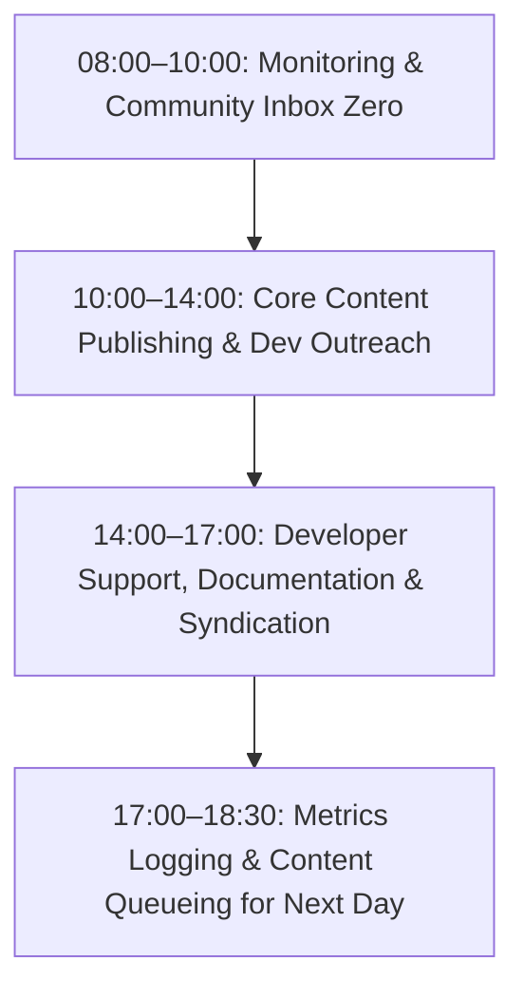

# ICPay Daily Marketing & Growth Operations Checklist

> **Operational Protocol**: High-discipline daily routines for DevRel, community engagement, content distribution, and growth analytics for ICPay.

---

## 1. Daily Workflow Overview

---

## 2. Morning Routine: Monitoring & Community Inbox Zero (08:00 – 10:00 UTC)

### A. Health & Platform Sanity Check
- [ ] **Canister Health & Cycles Status**:
  - Open `icpay.app/canisters` and verify backend canister (`6vbhm-nqaaa-aaaan-q6muq-cai`) cycles balance > 2 Trillion cycles.
  - Check error logs and ensure zero unhandled trapped calls on the ICP ledger bridge.
- [ ] **IcBucket Storage Metrics**:
  - Verify gateway streaming response times for sample public asset endpoints (`<bucket-id>.raw.ic0.app`).
  - Confirm chunked upload endpoints are responding with `< 100ms` pre-flight latency.

### B. Inbound Communication & Mentions
- [ ] **X / Twitter Mentions & DMs**:
  - Check `@ICPayApp` notifications, quote tweets, and direct messages.
  - Reply to all user inquiries within 15 minutes.
  - Like, retweet, or quote-tweet community members sharing their new `@handle` or IcBucket deployments.
- [ ] **DFINITY Developer Forum**:
  - Check `forum.dfinity.org` for new discussions tagged with `#canisters`, `#storage`, `#icrc-1`, or `#cycles`.
  - Provide constructive, value-first technical answers referencing open-source patterns or ICPay solutions where genuinely helpful.
- [ ] **Discord & Telegram Channels**:
  - Clear community support queries in `#support` and `#developers`.
  - Post morning greeting and highlight any new feature or fix merged into `main`.
- [ ] **GitHub Issues & PRs**:
  - Review open issues on `github.com/prasangapokharel/ICPay`.
  - Triage community bug reports and label them (`bug`, `documentation`, `good-first-issue`).

---

## 3. Mid-Day Execution: Core Content & Developer Outreach (10:00 – 14:00 UTC)

### A. High-Signal Content Publishing
- [ ] **Publish Daily X (Twitter) Content**:
  - Publish 1 primary scheduled post or technical thread between **11:00 and 13:00 UTC** (peak global engagement window).
  - *Post Formats (Rotate according to Day of Week)*:
    - **Monday**: Deep Architecture Thread (e.g., Subaccounts vs Principals; Single-round async ICRC-1 settlement).
    - **Tuesday**: 60s Screencast / GIF Demo (e.g., 1-Click Cycles top-up using CMC).
    - **Wednesday**: Developer Tip / Code Snippet (e.g., Motoko snippet for streaming chunked uploads to IcBucket).
    - **Thursday**: Industry Contrast / Thought Leadership (e.g., WebAuthn Hardware Enclave Passkeys vs Seed Phrases).
    - **Friday**: Ecosystem Ship Log / Weekly Changelog recap.
- [ ] **Engage with Ecosystem Leaders**:
  - Leave at least 5 substantive, thoughtful comments on posts from `@dfinity`, `@dominic_w`, ICP projects, and prominent Web3 developers.
  - Focus on technical substance rather than generic cheerleading.

### B. Direct Developer & Project Outreach
- [ ] **Targeted Builder Outreach (3–5 per day)**:
  - Identify 3 active ICP dApps, NFT projects, or tooling teams that currently manage canisters or store off-chain data.
  - Send personalized message highlighting specific benefits:
    - *For Canister Operators*: "Saw your project—ICPay gives you automated visual cycle runaway alerts and 1-click CMC refills."
    - *For dApps with Media*: "You're paying AWS S3 egress bills for frontends/NFTs—IcBucket runs 100% on-chain with zero egress costs."
  - Record outreach status in partnership pipeline.

---

## 4. Afternoon Operations: DevRel, Docs & Syndication (14:00 – 17:00 UTC)

### A. Technical Content Syndication & SEO
- [ ] **Cross-Post Educational Articles**:
  - Adapt weekly architectural threads into long-form markdown posts on **Dev.to**, **Medium**, **Hashnode**, or **Substack**.
  - Embed official repository links and clickable documentation URLs.
- [ ] **Reddit & Technical Forums**:
  - Check `r/internetcomputer`, `r/web3`, `r/crypto`, and `r/selfhosted`.
  - Participate in relevant discussions regarding cloud storage alternatives, decentralized payments, and developer workflows.

### B. Developer Experience & Documentation Polish
- [ ] **Review Feedback & Edge Cases**:
  - Did an onboarding developer get confused about an API parameter or cycle conversion rate?
  - Immediately update documentation or tooltips to eliminate friction for the next user.
- [ ] **SDK / Code Example Maintenance**:
  - Verify that all demo code snippets in `docs/` and READMEs compile cleanly against the latest canister interface definitions.

---

## 5. Evening Review: Metrics Logging & Next-Day Preparation (17:00 – 18:30 UTC)

### A. Metrics Tracking & Daily Scorecard
Log the following daily metrics into the growth dashboard / spreadsheet:
- [ ] **Total Registered `@handles`**: `[ _____ ]` (Delta: `+___`)
- [ ] **Active Canisters Monitored**: `[ _____ ]` (Delta: `+___`)
- [ ] **Total IcBuckets Created**: `[ _____ ]` (Delta: `+___`)
- [ ] **Total Storage Volume (GB)**: `[ _____ ]` (Delta: `+___ GB`)
- [ ] **24h Payment Volume (ICP / ckBTC)**: `[ _____ ]`
- [ ] **X Impressions & Engagements (24h)**: `[ _____ / _____ ]`
- [ ] **Unique Site Visitors (`icpay.app`)**: `[ _____ ]`

### B. Pre-Queue Next Day's Actions
- [ ] **Draft & Queue Tomorrow's Morning Content**:
  - Prepare copy, graphic/video asset, and technical tags for tomorrow's 11:00 UTC post.
- [ ] **Flag Urgent Blockers for Engineering**:
  - Report any recurring user friction or protocol questions to the core engineering team.

---

## 6. Weekly & Monthly Cadence Checklist

### Weekly Cadence
| Day | Task | Description |
| :--- | :--- | :--- |
| **Monday** | **Weekly Sprint Planning** | Review AARRR metrics from past 7 days; prioritize top 3 marketing experiments for the week. |
| **Wednesday** | **Mid-Week DevRel Review** | Audit feedback from developer outreach; follow up with dApp teams testing IcBucket. |
| **Friday** | **Weekly Ship Log & Changelog** | Publish comprehensive summary thread on X highlighting all deployed commits, features, and UI improvements. |
| **Saturday** | **Community Q&A / Spaces Prep** | Check weekly open questions across forum and Discord; prep topic list for next community space. |

### Monthly Cadence
- [ ] **Ecosystem Transparency Report**: Publish a monthly transparency report detailing volume processed, handles registered, storage capacity on IcBucket, and canister cycles saved.
- [ ] **DFINITY Grant Milestone Audit**: Review progress on grant deliverables and submit formal milestone verification to DFINITY Foundation.
- [ ] **Competitive & Benchmark Audit**: Benchmark ICPay and IcBucket latency and pricing against traditional cloud (AWS, Cloudflare) and Web3 alternatives.
