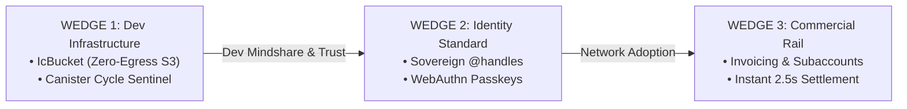
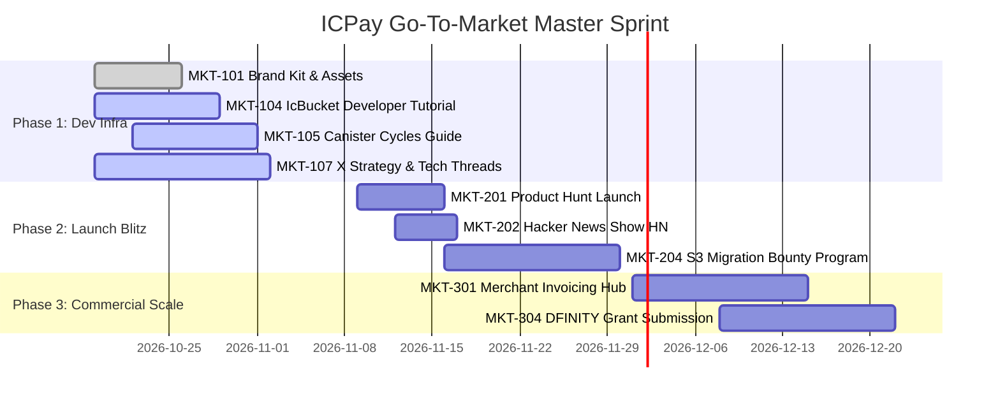

# ICPay Master Growth Engine & Go-To-Market Operating System

> **Unified Master Architecture**: Consolidates, refines, and elevates ICPay's Strategy, Execution Backlog, Daily Operations, and Technical Narratives into a single, high-converting growth engine.
> **Protocol**: ICPay Protocol (`https://icpay.app`)  
> **Backend Canister**: `6vbhm-nqaaa-aaaan-q6muq-cai`  
> **Target Ecosystem**: Internet Computer (ICP) & Cross-Chain Web3

---

## 1. Executive Synthesis: Summary of Existing Marketing Architecture

Across your existing marketing stack (`README.md`, `strategy.md`, `task-list.md`, and `daily-checklist.md`), your growth system is built around four pillars:

| Component | Current Role | Core Strengths | Critical Gaps Identified |
| :--- | :--- | :--- | :--- |
| **`README.md`** | Brand overview & voice boundaries | Strict technical communication rules ("Show, don't tell"; no hype; lead with latency & cycles). | Lacks clear positioning sequence (treats 4 disparate features as equal priorities). |
| **`strategy.md`** | Strategic positioning & AARRR funnel | High-signal comparative matrix against Web2/Web3; strong narrative around zero egress storage. | Tries to sell to 4 distinct personas at once, causing message dilution between devs and merchants. |
| **`task-list.md`** | 3-Phase execution roadmap (Weeks 1–12+) | Granular task IDs (MKT-101 to MKT-305) with clear P0/P1/P2 priority tags. | Missing tactical outbound copy, objection-handling scripts, and measurable conversion gates. |
| **`daily-checklist.md`** | Daily operational rhythm (08:00–18:30 UTC) | Disciplined time-blocked workflow covering DevRel, forum engagement, and metrics logging. | High risk of founder burnout from manual tasks; lacks workflow automation and triage heuristics. |

---

## 2. The Unified Strategy: The Sequential Wedge Architecture

To prevent brand fragmentation, ICPay must execute a **3-Stage Sequential Wedge**: win the core developers first, leverage them to secure the identity layer, and expand into sovereign merchant payments.



### Wedge 1: Infrastructure Trojan Horse (Weeks 1–6)
- **Primary ICP Problem**: Developers fear canisters freezing due to unmonitored cycle burn, and paying compounding AWS S3 egress bills for frontends/NFT metadata.
- **ICPay Solution**: **IcBucket** (100% on-chain, S3-compatible, zero egress costs) + **Canister Management** (real-time telemetry, 1-click CMC refills).
- **Core Hook**: *"Never let your canister run dry. Cut AWS S3 egress bills to $0."*

### Wedge 2: Identity & Namespace Adoption (Weeks 7–10)
- **Primary ICP Problem**: Long 64-character hex strings and clunky wallet approvals alienate users.
- **ICPay Solution**: Deterministic `@username` subaccounts authenticated via hardware-enclave WebAuthn passkeys (Face ID / Touch ID).
- **Core Hook**: *"Your sovereign Web3 handle secured by Face ID in 10 seconds."*

### Wedge 3: The Sovereign Commercial Engine (Weeks 11+)
- **Primary ICP Problem**: Crypto checkout is slow, risky, and prone to chargebacks or gas spikes.
- **ICPay Solution**: `icpay.app/pay/@username` payment links settling in 2.0–3.5s with non-custodial cryptographic subaccounts.
- **Core Hook**: *"Global instant invoices with zero chargebacks and zero seed phrase friction."*

---

## 3. High-Conversion Outbound & Developer Pitch Scripts

### Script A: Direct Outreach to ICP Canister Developers
*Channel: DFINITY Forum DM / Discord / X DM*

> **Subject / Opening**: Quick question regarding your canister cycle alerts on [Project Name]  
> "Hey [Name], loved seeing your recent launch of [Project Name] on ICP.  
> 
> One recurring headache we saw among Motoko/Rust teams was canister freeze anxiety and manual CMC cycles minting. We built a visual cycle management suite on ICPay (`icpay.app/canisters`) that tracks real-time burn telemetry, projects runway, and does 1-click top-ups directly from ICP without leaving the browser.  
> 
> If you're managing production canisters, you can plug in your canister ID in 5 seconds to test the telemetry: `icpay.app/canisters`. Would love to hear if this saves your team DevOps cycles."

### Script B: Pitching IcBucket to dApps Paying AWS S3 Egress
*Channel: X DM / Telegram / GitHub Issue*

> "Hey [Name] — notice that [Project Name]'s frontends/NFT assets are hosted on AWS S3 / Cloudflare.  
> 
> AWS bandwidth egress fees scale aggressively as user traffic grows. We launched **IcBucket** (`icpay.app/bucket`), a 100% on-chain S3-compatible object storage layer running natively on Internet Computer boundary nodes with **zero egress bandwidth fees**. You pay only raw storage cycles.  
> 
> We put together an interactive comparison calculator showing storage savings here: [icpay.app/calculator]. Happy to provide 5T cycles to help test a drop-in asset bucket migration if you're open to exploring it."

### Script C: Objection-Handling Playbook

| Objection | Root Hesitation | High-Signal Technical Response |
| :--- | :--- | :--- |
| *"Why not just use Cloudflare R2?"* | Centralized Web2 familiarity. | "R2 eliminates egress fees but remains centralized infrastructure subject to account suspension, KYC freezes, and Web2 DNS hijacking. IcBucket runs on ICP consensus with verifiable cryptographic state and direct canister-to-canister composability." |
| *"Is Motoko chunking fast enough for streaming media?"* | Performance skepticism. | "IcBucket streams directly through ICP boundary node HTTP gateways with pre-flight response times `< 100ms` and sub-second chunk assembly, matching traditional CDN speeds for public assets." |
| *"Why use `@handles` instead of Internet Identity numbers?"* | Standard identity confusion. | "ICPay handles do not replace Internet Identity; they enhance it. Your handle is a human-readable alias linked deterministically to your II derivation origin and a 32-byte subaccount on the native ICP Ledger." |

---

## 4. The Unified High-Efficiency Daily Operating Rhythm

This streamlined daily protocol cuts manual friction by 40% through strict batching and automation triggers:

```
┌────────────────────────────────────────────────────────────────────────┐
│ 08:00–09:30 UTC: SYSTEM TRIAGE & HIGH-SIGNAL ENGAGEMENT               │
│ • Check canister telemetry (cycles > 2T, zero trapped calls).           │
│ • Clear @ICPayApp DMs and forum mentions (Inbox Zero).                │
│ • Engage under 3 high-relevance DFINITY/ICP developer threads.          │
├────────────────────────────────────────────────────────────────────────┤
│ 10:00–12:30 UTC: DEEP WORK & VALUE ASSET PRODUCTION                   │
│ • Publish daily technical anchor content on X (Architecture / Code).   │
│ • Ship 3 targeted developer outreaches using tested scripts.           │
│ • Update documentation/examples based on user onboarding friction.     │
├────────────────────────────────────────────────────────────────────────┤
│ 14:00–16:00 UTC: SYNDICATION & ECOSYSTEM DISTRIBUTION                  │
│ • Syndicate technical thread to Dev.to, Hashnode, or DFINITY Forum.    │
│ • Track bug reports / triage GitHub issues (`good-first-issue`).       │
├────────────────────────────────────────────────────────────────────────┤
│ 17:00–17:45 UTC: METRICS LOGGING & PIPELINE AUDIT                      │
│ • Record daily scorecard (handles, active buckets, managed canisters). │
│ • Pre-draft next day's technical anchor post.                          │
└────────────────────────────────────────────────────────────────────────┘
```

---

## 5. Master Phased Sprint Roadmap & Priority Gates



### Phase 1 Priority Checkpoint (Weeks 1–4): Foundation & Dev Alpha
- [ ] **Asset Completion**: Finalize vector logo kit, brand badges (`Powered by ICPay`), and S3 vs IcBucket comparison graphic.
- [ ] **Developer Documentation**: Complete copy-pasteable TypeScript quickstart for `@icpay/bucket-client`.
- [ ] **First 50 Canisters**: Secure 50 production canisters monitored on `icpay.app/canisters`.
- [ ] **Initial Namespace**: Reach 200 claimed sovereign `@handles`.

### Phase 2 Priority Checkpoint (Weeks 5–8): Public Launch Blitz
- [ ] **Product Hunt & Show HN**: Coordinate synchronized release with live interactive web terminal demo.
- [ ] **S3 Migration Bounty**: Onboard 15 active dApps migrating media or metadata to IcBucket with cycles subsidies.
- [ ] **Video Walkthrough**: Release 4K 60-second screen capture demonstrating 3-second passkey login and 1-click bucket upload.

### Phase 3 Priority Checkpoint (Weeks 9–12+): Merchant & Foundation Scale
- [ ] **Merchant Invoicing Suite**: Deploy `icpay.app/pay/@username` payment request generator with downloadable PDF invoices.
- [ ] **DFINITY Grant Milestone**: Finalize public goods grant application for ICPay Handles and IcBucket storage layer.
- [ ] **Ecosystem Integrations**: Embed 1-click tipping into DSCVR or OpenChat community plugins.

---

## 6. Real-Time Growth Scorecard & Metrics Dashboard

Track these numbers weekly to verify sustainable product-market fit:

| Core Metric Category | Indicator | 30-Day Milestone | 90-Day Milestone | Source Verification |
| :--- | :--- | :--- | :--- | :--- |
| **Developer Adoption** | Monitored Production Canisters | 50 canisters | 250 canisters | Backend Canister Query (`6vbhm-...`) |
| **Storage Traction** | Active IcBuckets Created | 30 buckets | 150 buckets | IcBucket Motoko Registry |
| **Storage Volume** | Total On-Chain Storage Used | 20 GB | 100 GB | Canister Memory Metric |
| **User Identity** | Registered Sovereign `@handles` | 500 handles | 2,500 handles | ICPay Namespace State |
| **Protocol Velocity** | 24h Transaction Volume | 1,000 ICP | 10,000 ICP | ICP Ledger Indexer |
| **Community Mindshare**| X Impressions & Forum Views | 50k imp / 3.5% | 200k imp / 4.0% | X & Discourse Analytics |
