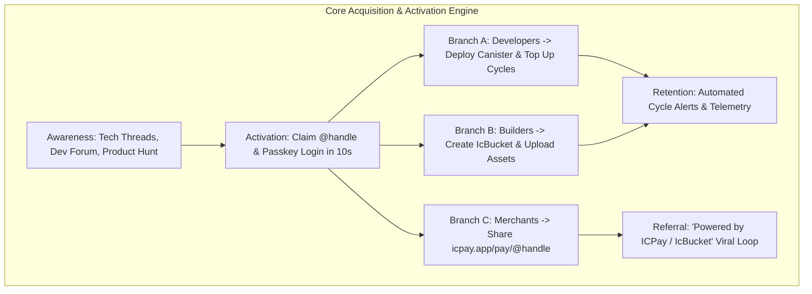

# ICPay Go-To-Market (GTM) & Marketing Strategy

> **Protocol**: ICPay (`https://icpay.app`)  
> **Ecosystem**: Internet Computer (ICP) Native Financial & Resource Cloud  
> **Version**: 1.0 — Marketing & Growth Architecture

---

## 1. Executive Summary & Market Positioning

ICPay bridges the gap between Web2 user simplicity and sovereign Web3 decentralization. By leveraging the Internet Computer's native capabilities (reverse gas model, sub-second to multi-second finality, 100% on-chain compute & storage, and WebAuthn/Internet Identity), ICPay dissolves the four biggest friction points of crypto:
1. **Cognitive Address Complexity**: Replacing 64-character hex strings with sovereign `@username` handles.
2. **Seed Phrase Fear**: Eliminating seed phrase custody through hardware-enclave biometric passkeys (Touch ID, Face ID, YubiKey).
3. **High Egress & Storage Costs**: Delivering **IcBucket**—a 100% on-chain S3-compatible object storage layer with **zero egress fees**, paying only canister cycles.
4. **DevOps Overhead for Canisters**: Providing automated, self-custodial canister deployment, cycles top-up via CMC (Cycles Minting Canister), and telemetry (**ICFalcon**).

### Positioning Matrix

| ICPay Pillar | Traditional Solution | Legacy Web3 Solution | ICPay Sovereign Advantage |
| :--- | :--- | :--- | :--- |
| **Payments** | Stripe / PayPal (2.9% + 30¢, chargebacks, KYC lockouts) | MetaMask / Phantom (Seed phrases, 0x hex addresses, gas spikes) | Instant 2.5s finality, subaccount `@username`, 0 chargebacks, 0 seed phrases |
| **Object Storage (IcBucket)** | AWS S3 / Cloudflare R2 (Exorbitant egress bandwidth, centralized censorship) | IPFS / Filecoin / Arweave (Complex pinners, gateway timeouts, slow writes) | 100% On-chain canister storage, zero egress fees, direct HTTP gateway streaming |
| **Canister Operations** | AWS EC2 / Datadog (Fragmented credit cards, complex IAM) | DFX CLI / Manual scripts (No real-time alerts, risk of canister freezing) | Visual cycle dashboard, auto-refill via Cycles Ledger/CMC, multi-controller governance |
| **Developer Tools (ICFalcon)** | Sentry / CloudWatch | Custom Motoko telemetry scripts | Native WASM hash verification, automated upgrades, telemetry canister hooks |

---

## 2. Target Customer Personas & Value Propositions

### Persona A: The ICP Canister Developer & Builder
- **Profile**: Building Motoko or Rust canisters on the Internet Computer. Struggles with manual cycle top-ups, canister freeze paranoia, and complex asset canister hosting.
- **Pain Points**: Running out of cycles in production; managing multiple controllers; tedious asset uploads.
- **Core Value Proposition**: 
  - *"Never let your canister run out of cycles again."*
  - Top up canisters using native ICP or cycles with a single click.
  - Manage controllers, view real-time cycle burn rates, and snapshot canister states.
  - Store assets, NFT media, and build artifacts directly in **IcBucket** with S3-like API keys.

### Persona B: The Web3 / Cross-Chain dApp Founder
- **Profile**: Ethereum, Solana, or L2 founder seeking decentralized storage or micropayments without AWS bill surprises.
- **Pain Points**: AWS S3 egress bills multiplying as users scale; IPFS pinning services (Pinata, Infura) failing or experiencing gateway throttling.
- **Core Value Proposition**:
  - *"Decentralized S3 storage that actually performs—with 0 egress bills."*
  - 100% on-chain persistence backed by ICP consensus.
  - Direct boundary-node CDN caching, instant HTTP streaming, and granular bucket permissions.

### Persona C: The Web3 Merchant, Creator & Freelancer
- **Profile**: Digital freelancers, indie hackers, SaaS operators, and NFT creators accepting crypto worldwide.
- **Pain Points**: Stripe account bans for cross-border transactions; high Ethereum gas fees ($5–$20 per tx); clumsy customer wallet UX requiring seed phrases.
- **Core Value Proposition**:
  - *"Get paid in seconds at `@yourname` with zero seed phrase friction."*
  - Clean shareable payment links (`icpay.app/pay/@username`).
  - Zero chargeback risk, instant finality in ICP, ckBTC, or ckETH.
  - Non-custodial subaccounts ensuring full ownership of funds.

### Persona D: The Retail ICP Ecosystem User
- **Profile**: ICP token holders, DeFi traders, and community members.
- **Pain Points**: Remembering long canister IDs and principal IDs; complex ledger transfers.
- **Core Value Proposition**:
  - Claim a permanent, sovereign `@username` handle on the Internet Computer.
  - Log in with biometric FaceID/TouchID in 1 click.
  - Send and receive ICP ecosystem assets seamlessly.

---

## 3. Product-Specific Go-To-Market Playbooks



### 3.1. ICPay Core Payments & Handles
- **The Hook**: "Stop sending crypto to `7b3f9...c4a1`. Claim your sovereign `@handle` on ICP in 10 seconds with Face ID."
- **Key Features to Highlight**:
  - Hardware passkey authentication (Internet Identity / WebAuthn).
  - Deterministic 32-byte subaccounts: funds live on the ICP Ledger Canister directly under user-controlled derivation.
  - Shareable payment links (`icpay.app/pay/@alice?amount=5&token=ICP`).
- **Growth Loops**:
  - **Payment Receipt Loop**: Every payment invoice and receipt includes a clean, branded footer: *"Settled via ICPay. Claim your handle at icpay.app"*.
  - **Vanity Handle Rush**: Gamified tier drops for short usernames (3-letter, 4-letter handles) for active community contributors.

### 3.2. IcBucket (Decentralized On-Chain S3)
- **The Hook**: "AWS S3 egress bandwidth is a tax on your growth. IcBucket gives you 100% on-chain object storage with 0 egress costs."
- **Key Features to Highlight**:
  - S3-compatible chunking engine natively in Motoko.
  - Direct HTTP gateway streaming through Internet Computer boundary nodes.
  - Developer API keys and granular read/write ACLs.
  - Automatic cycle consumption tracking per bucket.
- **Distribution Tactics**:
  - **"AWS S3 vs IcBucket Cost Calculator"**: Interactive infographic / blog post showing cost savings for 10TB of monthly egress.
  - **SDK / CLI Drop**: Launching `@icpay/bucket-client` npm package and Python SDK for instant drop-in integration.
  - **Media CDN for NFT/dApp Projects**: Partnering with top ICP NFT marketplaces and frontend hosts to migrate metadata to IcBucket.

### 3.3. Canister Management & Cycles Operations Suite
- **The Hook**: "Your canister's cycles shouldn't keep you awake at night. Visual management, 1-click CMC minting, and multi-controller security."
- **Key Features to Highlight**:
  - Real-time cycle balance, burn rate, and projected runaway estimates.
  - Direct ICP-to-Cycles conversion through the Cycles Minting Canister (CMC) without leaving the browser.
  - One-click controller additions, compute allocation tuning, and memory limit controls.
- **Distribution Tactics**:
  - **DFINITY Developer Forum Feature Thread**: In-depth breakdown of canister lifecycle management best practices.
  - **"Canister Emergency Rescue"**: Educational guide on how to rescue freezing canisters using ICPay before memory thresholds lock state.

### 3.4. ICFalcon Developer Tooling & Ecosystem SDK
- **The Hook**: "Production-grade Motoko/Rust canister telemetry and deterministic deployment."
- **Key Features to Highlight**:
  - WASM hash verification against GitHub releases.
  - State snapshotting and automated rollback orchestration.
- **Distribution Tactics**:
  - Open-source GitHub repositories with high-quality CI/CD action templates.
  - Integration with popular ICP starter templates (`create-ic-app`, `mops`).

---

## 4. Multi-Channel Distribution & Community Architecture

### 4.1. Crypto Twitter / X Strategy
Twitter/X is the primary arena for Web3 developer mindshare and ecosystem momentum.
- **Content Rhythms**:
  - **Monday**: Architecture deep dive / Technical thread (e.g., *"How ICPay executes parallel ICRC-1 transfers in 2.5s with zero subaccount locking"*).
  - **Tuesday**: Feature highlight & video walkthrough (60-second clean screen capture of IcBucket or Canister Manager).
  - **Wednesday**: Community spotlight / Ecosystem builder shoutout using ICPay or IcBucket.
  - **Thursday**: Comparative benchmark / Educational post (*"Why Web3 needs WebAuthn passkeys instead of 24-word seed phrases"*).
  - **Friday**: Product updates, ship log, changelog, and weekly metrics recap.
- **Hashtag & Tagging Strategy**:
  - Primary tags: `#InternetComputer`, `#ICP`, `#Web3Dev`, `#DecentralizedCloud`.
  - Mentions: Engage constructively under `@dfinity`, `@dominic_w`, and ICP ecosystem leaders' threads.

### 4.2. DFINITY Developer Forum & Technical Communities
- **DFINITY Forum (`forum.dfinity.org`)**:
  - Post comprehensive, technical, non-spammy dev updates under *Developers* and *Showcase*.
  - Provide code examples showing how developers can call the ICPay backend canister (`6vbhm-nqaaa-aaaan-q6muq-cai`) or embed IcBucket.
  - Actively answer community questions on cycles management, ICRC standards, and WebAuthn derivation.
- **Discord & Telegram**:
  - Maintain an active presence in DFINITY Developer Discord and ICP Ecosystem groups.
  - Host weekly "Office Hours" or async Q&A for developers integrating the ICPay SDK.

### 4.3. Developer SEO, Documentation & Technical Blogging
- **Platforms**: Official ICPay Blog, Medium, Dev.to, Hashnode, Substack.
- **Key Evergreen Search Queries to Capture**:
  - *"How to top up ICP canister with cycles"*
  - *"Decentralized AWS S3 alternative with no egress fees"*
  - *"Internet Computer WebAuthn passkey authentication tutorial"*
  - *"Accept crypto payments without seed phrases"*
  - *"ICRC-1 vs ICRC-2 payment flow explained"*

### 4.4. Hackathons, Grants & Ecosystem Partnerships
- **DFINITY Foundation Developer Grants**: Present ICPay as essential public goods infrastructure (sovereign namespace + cycles management + on-chain storage).
- **ICP Hackathon Sponsorship**: Sponsor a dedicated "Best dApp using IcBucket for Storage" or "Best Use of ICPay Handles" bounty prize.
- **Cross-dApp Integrations**:
  - Partner with decentralized social protocols (DSCVR, OpenChat, Taggr) to enable 1-click tips via `@username`.
  - Partner with NFT marketplaces to store all high-res master files on IcBucket.

### 4.5. Product Hunt & Public Aggregator Launches
- Execute coordinated launch day on Product Hunt, Hacker News Show HN, and BetaList:
  - **Product Hunt Title**: *"ICPay — Decentralized Cloud Storage & Sovereign Web3 Financial OS"*
  - **Show HN Title**: *"Show HN: IcBucket – 100% on-chain S3-compatible storage with zero egress fees (ICP)"*
  - **Assets Required**: 4K video teaser, interactive demo link, comparison chart, live playground.

---

## 5. Growth Loops & Virality Mechanics

```
┌────────────────────────────────────────────────────────┐
│                   1. User Onboards                     │
│           (Passkey / TouchID -> Claims @name)          │
└───────────────────────────┬────────────────────────────┘
                            │
                            ▼
┌────────────────────────────────────────────────────────┐
│               2. User Sends Payment Link               │
│               (icpay.app/pay/@username)                │
└───────────────────────────┬────────────────────────────┘
                            │
                            ▼
┌────────────────────────────────────────────────────────┐
│            3. Recipient/Customer Experiences           │
│      - Instant 2.5s Settlement                         │
│      - Clean UI / No Gas Math                          │
│      - "Create your free sovereign handle" prompt      │
└───────────────────────────┬────────────────────────────┘
                            │
                            ▼
┌────────────────────────────────────────────────────────┐
│            4. Recipient Becomes New User               │
│        (New Handle Claimed -> Growth Loop Closes)      │
└────────────────────────────────────────────────────────┘
```

1. **The Sovereign Handle Viral Loop**:
   - Every payment link sent to a client or friend acts as an interactive billboard for the ICPay platform.
   - Payer sees the effortless UI and is offered to claim their own free handle immediately after confirmation.

2. **The IcBucket Public URL Loop**:
   - Any public image, document, or asset hosted on IcBucket and served through the boundary node can include custom HTTP response headers (`X-Powered-By: IcBucket (icpay.app)`) or optional clean preview wrappers.

3. **Developer Badge Loop**:
   - Markdown badge for GitHub READMEs:
     ```markdown
     [](https://icpay.app)
     [](https://icpay.app/bucket)
     ```

---

## 6. Metrics & KPI Framework (AARRR Funnel)

| Funnel Stage | Key Performance Indicator (KPI) | Target (30 Days) | Target (90 Days) | Tracking Tool |
| :--- | :--- | :--- | :--- | :--- |
| **Acquisition** | Unique Website Visitors (`icpay.app`) | 5,000 / mo | 25,000 / mo | Cloudflare / Plausible |
| **Acquisition** | X Impressions & Engagement Rate | 50k imp / 3.5% | 200k imp / 4.0% | X Analytics |
| **Activation** | Registered Sovereign `@handles` | 500 handles | 2,500 handles | Backend Canister Query |
| **Activation** | Canisters Managed in Dashboard | 50 canisters | 250 canisters | Backend Canister Query |
| **Activation** | Active IcBuckets Created | 30 buckets | 150 buckets | Motoko Bucket Registry |
| **Retention** | 30-Day Active Handle Users (Transactions) | 25% | 40% | ICP Index Canister |
| **Revenue/Volume** | Total Volume Processed (ICP / ckBTC) | 1,000 ICP | 10,000 ICP | ICP Ledger Audit |
| **Revenue/Usage** | Total Storage Stored on IcBucket | 20 GB | 100 GB | IcBucket Canister State |
