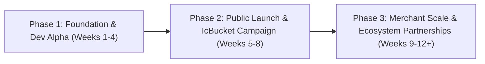

# ICPay Marketing & Growth Task List

> **Master Execution Backlog**  
> **Status Tracking**: Organized by Phase, Workstream, and Priority (P0 = Critical, P1 = High, P2 = Medium).

---

## 1. Execution Roadmap Overview

---

## 2. Phase 1: Foundation, Brand Assets & Developer Alpha (Weeks 1–4)

*Goal: Establish brand identity, launch official documentation hubs, onboard initial 50 developer beta testers for IcBucket and Canister Management, and achieve first 200 sovereign `@handle` registrations.*

### Workstream 1: Brand & Positioning Assets
- [ ] **MKT-101** | **Brand Kit & Media Pack** `[P0]`
  - *Description*: Create downloadable press kit containing high-res ICPay vector logos (dark & light), IcBucket icon badges, typography guidelines, and brand color palette definitions.
  - *Deliverable*: `/public/brand-kit.zip` and dedicated `icpay.app/brand` page.
  - *Success Criteria*: 100% vector SVG assets available for community and media outlets.
- [ ] **MKT-102** | **Product Explainer One-Pager (PDF/Web)** `[P0]`
  - *Description*: Design a high-impact, visual two-page overview summarizing ICPay Sovereign Accounts, IcBucket Zero-Egress Storage, and Canister Management.
  - *Deliverable*: `docs/marketing/assets/icpay-overview.pdf`.
  - *Success Criteria*: Distributed to DFINITY Foundation grant leads and ecosystem angels.
- [ ] **MKT-103** | **Interactive "AWS S3 vs IcBucket" Infographic** `[P1]`
  - *Description*: Produce a side-by-side comparison chart illustrating storage costs, egress bills at 1TB / 10TB / 50TB, and security models.
  - *Deliverable*: High-res SVG graphic + interactive web calculator on landing page.
  - *Success Criteria*: Ready for sharing on X and Hacker News.

### Workstream 2: Developer Relations & Technical Content
- [ ] **MKT-104** | **Interactive Quickstart Guide for IcBucket** `[P0]`
  - *Description*: Publish a step-by-step developer tutorial: *"Store your first 1GB on the Internet Computer with IcBucket in under 3 minutes"*.
  - *Deliverable*: Blog post on Dev.to and official docs entry with copy-pasteable JavaScript/TypeScript code snippets.
  - *Success Criteria*: Tested end-to-end with zero terminal errors.
- [ ] **MKT-105** | **Canister Management & Cycles Operations Guide** `[P0]`
  - *Description*: Write an in-depth operational guide: *"How to prevent canister freezing: automated cycles top-up and CMC integration"*.
  - *Deliverable*: Published on DFINITY Developer Forum with architectural diagrams.
  - *Success Criteria*: 500+ views and 20+ likes on DFINITY Forum.
- [ ] **MKT-106** | **GitHub Readme Badges & Repository Overhaul** `[P1]`
  - *Description*: Deploy official SVG status badges for developer repositories (`Powered by ICPay`, `Stored on IcBucket`, `Canister Verified`).
  - *Deliverable*: Asset files in `frontend/public/badges/` and instructions in `README.md`.
  - *Success Criteria*: Adopted by at least 3 open-source ICP projects during alpha.

### Workstream 3: Social & Channel Setup
- [ ] **MKT-107** | **Official X (Twitter) Channel Strategy Setup** `[P0]`
  - *Description*: Optimize `@ICPayApp` profile: banner, pinned tweet thread explaining sovereign handles & passkeys, link-in-bio to `icpay.app`.
  - *Deliverable*: Live profile with first 5 scheduled architectural threads.
  - *Success Criteria*: 500 organic followers in first 30 days.
- [ ] **MKT-108** | **DFINITY Community Showcase Thread** `[P0]`
  - *Description*: Author the official announcement thread on `forum.dfinity.org` introducing ICPay Protocol v2.4, open-sourcing the architecture, and inviting community testers.
  - *Deliverable*: Comprehensive forum post including canister IDs and live demo links.
  - *Success Criteria*: Engagement from DFINITY core engineers / DevRel team.
- [ ] **MKT-109** | **Discord & Telegram Community Hub** `[P1]`
  - *Description*: Set up official ICPay Telegram and Discord channels with bot verifications, automated GitHub release feeds, and support tickets.
  - *Deliverable*: Configured Discord server with roles (`Builder`, `Canister Operator`, `Ambassador`).
  - *Success Criteria*: 150 verified community members.

---

## 3. Phase 2: Public Launch & IcBucket Campaign (Weeks 5–8)

*Goal: Execute public launch blitz across Product Hunt, Hacker News, and X; scale IcBucket to 100+ active buckets; onboard 50 canisters under management; reach 1,000 registered `@handles`.*

### Workstream 1: Launch Campaigns & PR
- [ ] **MKT-201** | **Product Hunt Launch Day Coordination** `[P0]`
  - *Description*: Orchestrate official Product Hunt launch. Prepare gallery screenshots, animated feature GIFs, founder first-comment, and hunter outreach.
  - *Deliverable*: Live Product Hunt campaign page.
  - *Success Criteria*: Top 5 Product of the Day in Web3 / Developer Tools category.
- [ ] **MKT-202** | **Hacker News "Show HN" Campaign** `[P0]`
  - *Description*: Write authentic, technically grounded Show HN post: *"Show HN: IcBucket – 100% on-chain S3 alternative with 0 egress costs"*.
  - *Deliverable*: Submission with live interactive web terminal demo.
  - *Success Criteria*: Reaches front page or top 20 of Show HN.
- [ ] **MKT-203** | **Video Product Walkthrough (4K)** `[P1]`
  - *Description*: Produce a polished 90-second product demo showcasing: Passkey login (3s) -> Claiming `@handle` -> Uploading file to IcBucket -> One-click Cycles top-up.
  - *Deliverable*: YouTube video (unlisted preview then public) and native X video post.
  - *Success Criteria*: 10,000+ views on X.

### Workstream 2: Developer Ecosystem Growth
- [ ] **MKT-204** | **"Migrate from AWS S3 to IcBucket" Bounty Program** `[P1]`
  - *Description*: Launch a mini-grant / cycles subsidy program: first 20 dApps that migrate media or metadata to IcBucket receive 5 Trillion Cycles for storage.
  - *Deliverable*: Landing page section + application form.
  - *Success Criteria*: 15 verified dApp migrations.
- [ ] **MKT-205** | **DFINITY Ecosystem Community Spaces / AMA** `[P0]`
  - *Description*: Host an X Spaces / AMA session with prominent ICP community leaders discussing decentralized storage and sovereign identity.
  - *Deliverable*: 60-minute recorded audio session + key takeaways recap thread.
  - *Success Criteria*: 300+ live listeners.
- [ ] **MKT-206** | **NPM Package Launch Campaign (`@icpay/sdk`)** `[P1]`
  - *Description*: Official launch of the TypeScript SDK for integrating ICPay handles and IcBucket uploads in any web application.
  - *Deliverable*: Published npm package with complete README and CodeSandbox interactive demo.
  - *Success Criteria*: 100+ weekly npm downloads.

---

## 4. Phase 3: Merchant Adoption, Ecosystem Scaling & Enterprise (Weeks 9–12+)

*Goal: Expand beyond pure developer use cases into e-commerce, digital invoicing, creator payments, and institutional dApp partnerships.*

### Workstream 1: Merchant & Freelancer Adoption
- [ ] **MKT-301** | **E-Commerce & Freelancer Invoicing Hub** `[P0]`
  - *Description*: Launch dedicated landing page for freelancers and digital merchants (`icpay.app/merchants`) showing instant payment links and zero-chargeback settlement.
  - *Deliverable*: Dedicated landing page, downloadable invoice templates with embedded ICPay payment links.
  - *Success Criteria*: 50 active merchants utilizing ICPay links for invoices.
- [ ] **MKT-302** | **Shopify / WooCommerce Integration Concept Plugin** `[P1]`
  - *Description*: Develop a lightweight Web3 checkout snippet allowing online stores to accept ICP / ckBTC using ICPay handles.
  - *Deliverable*: Open-source GitHub repository with plugin code and documentation.
  - *Success Criteria*: 5 pilot merchants testing in live environments.
- [ ] **MKT-303** | **Case Studies: Real-World Cost Savings** `[P1]`
  - *Description*: Interview early IcBucket and Canister Manager adopters and publish detailed case studies: *"How [Project] reduced cloud storage bills by 85% using IcBucket"*.
  - *Deliverable*: 2 published case study articles with metrics and quotes.
  - *Success Criteria*: Widely shared by ecosystem newsletters and DFINITY official channels.

### Workstream 2: Institutional & Foundation Relations
- [ ] **MKT-304** | **DFINITY Foundation Grant Proposal Submission** `[P0]`
  - *Description*: Finalize and submit comprehensive DFINITY Developer Grant application highlighting public goods infrastructure (ICPay Handles standard & IcBucket public storage).
  - *Deliverable*: Formal grant application with milestones, architectural proofs, and audit logs.
  - *Success Criteria*: Grant review acceptance and milestone funding.
- [ ] **MKT-305** | **Global ICP Hackathon Sponsorship & Mentorship** `[P1]`
  - *Description*: Provide developer mentorship and dedicated tracks at official ICP hackathons for teams building on ICPay SDK and IcBucket.
  - *Deliverable*: Hackathon workshop recording and judging participation.
  - *Success Criteria*: 10+ hackathon projects integrating ICPay.

---

## 5. Summary Tracking Table

| Task ID | Task Title | Owner | Priority | Target Phase | Status |
| :--- | :--- | :--- | :--- | :--- | :--- |
| **MKT-101** | Brand Kit & Media Pack | Design / Marketing | `P0` | Phase 1 | `[ ] Ready` |
| **MKT-102** | Product Explainer One-Pager | Content | `P0` | Phase 1 | `[ ] Ready` |
| **MKT-103** | S3 vs IcBucket Infographic | Design / DevRel | `P1` | Phase 1 | `[ ] Ready` |
| **MKT-104** | IcBucket Quickstart Tutorial | DevRel | `P0` | Phase 1 | `[ ] Ready` |
| **MKT-105** | Canister Management Guide | DevRel | `P0` | Phase 1 | `[ ] Ready` |
| **MKT-106** | GitHub Badges & Repos | Engineering | `P1` | Phase 1 | `[ ] Ready` |
| **MKT-107** | Official X Setup & Threads | Social Media | `P0` | Phase 1 | `[ ] Ready` |
| **MKT-108** | DFINITY Forum Showcase | Founders / DevRel | `P0` | Phase 1 | `[ ] Ready` |
| **MKT-109** | Discord & Telegram Community | Community Mgr | `P1` | Phase 1 | `[ ] Ready` |
| **MKT-201** | Product Hunt Launch | Full Team | `P0` | Phase 2 | `[ ] Scheduled` |
| **MKT-202** | Hacker News Show HN | DevRel / Tech Lead | `P0` | Phase 2 | `[ ] Scheduled` |
| **MKT-203** | 4K Product Walkthrough Video | Creative | `P1` | Phase 2 | `[ ] Scheduled` |
| **MKT-204** | S3 Migration Bounty Program | Growth | `P1` | Phase 2 | `[ ] Scheduled` |
| **MKT-205** | Community X Spaces / AMA | Growth / Founders | `P0` | Phase 2 | `[ ] Scheduled` |
| **MKT-206** | NPM Package Launch Campaign | DevRel / Eng | `P1` | Phase 2 | `[ ] Scheduled` |
| **MKT-301** | Merchant Invoicing Hub | Growth / UI | `P0` | Phase 3 | `[ ] Backlog` |
| **MKT-302** | E-Commerce Snippet / Plugin | Engineering | `P1` | Phase 3 | `[ ] Backlog` |
| **MKT-303** | Customer Case Studies | Content | `P1` | Phase 3 | `[ ] Backlog` |
| **MKT-304** | DFINITY Grant Proposal | Founders | `P0` | Phase 3 | `[ ] Backlog` |
| **MKT-305** | Hackathon Sponsorship | DevRel | `P1` | Phase 3 | `[ ] Backlog` |
