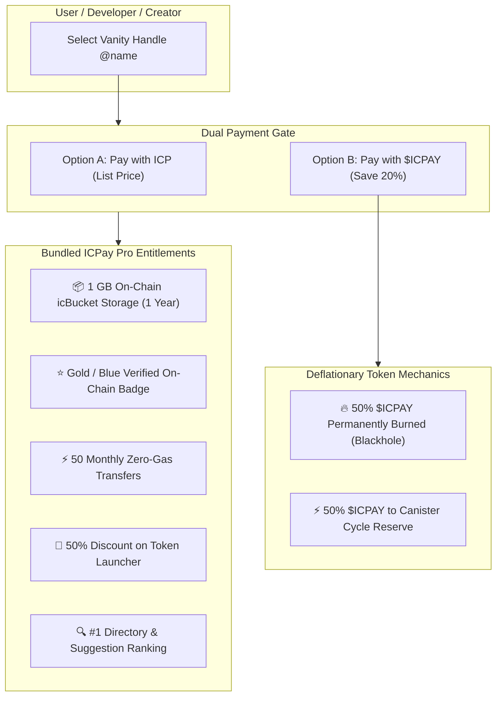

# ICPay Pro Business Model & $ICPAY Utility Implementation Blueprint

**Document**: `docs/plan/businessmodelutilit.md`  
**Version**: 1.0.0 (Production Blueprint)  
**Status**: Approved Architecture & Implementation Guide  

---

## 1. System Vision & Economic Flywheel

ICPay transforms username purchases from static string claims into an **ICPay Pro Identity & Utility Pass**. This aligns user incentives, drives organic buying pressure for the native **$ICPAY token**, and bundles decentralized storage without creating runaway canister cycle liabilities.



---

## 2. Core Strategic Invariants & Guardrails

1. **Time-Bounded Storage (1 GB for 1 Year)**:
   - **No Lifetime Storage**: Perpetual storage on-chain creates permanent cycle burn liabilities.
   - Storage is granted as a **12-Month 1 GB Lease** in `icBucket` (`icp_blob_store`).
   - Unit economics: 1 GB for 1 year costs ~0.4 ICP in cycle burn. On a 5–10 ICP purchase, the net treasury margin exceeds 90%.
   - **Renewal**: After 12 months, users can renew or upgrade using $ICPAY at a preferential rate or ICP.
2. **Backward-Compatibility for Existing Premium Users**:
   - Users who already hold 1–4 character handles (Gold/Blue badges) automatically receive the **1 GB for 1 Year** cloud storage benefit without paying again.
3. **Zero Migration Required**:
   - Entitlements are derived dynamically from handle length (`len <= 3` = Gold, `len == 4` = Blue).
   - No database schema modification, no data migrations, and zero risk to the 3.0 GiB Wasm memory ceiling.
4. **Zero Custodial Heap Load**:
   - Raw file bytes remain strictly isolated in `icp_blob_store` (`fly6t-piaaa-aaaan-q6oga-cai`).
   - The custodial wallet canister (`icp_wallet_backend`) maintains its high-water mark memory baseline.

---

## 3. Tier Matrix & Dual-Currency Economics

| Tier | Length | Price (ICP) | Price ($ICPAY) | Effective Savings | icBucket Cloud Storage | Monthly Free Transfers | Launcher Discount | Badge Rank |
|---|---|---|---|---|---|---|---|---|
| **Gold Ultra** | 1–3 chars | **10 ICP** | **160,000 ICPAY** | **20% OFF** | **1 GB for 1 Year** | 50 transfers/mo | 50% off (2.5 ICP) | Gold Tick (#1 Rank) |
| **Blue Premium** | 4 chars | **5 ICP** | **85,000 ICPAY** | **15% OFF** | **1 GB for 1 Year** | 30 transfers/mo | 25% off (3.75 ICP) | Blue Tick (#2 Rank) |
| **Standard** | 5 chars | **2 ICP** | **35,000 ICPAY** | **12.5% OFF** | 250 MB for 1 Year | 10 transfers/mo | — | Verified Identity |
| **Basic / Alias** | 6–8 chars | **1 ICP** | **18,000 ICPAY** | **10% OFF** | 100 MB Starter | — | — | Standard Alias |

*Note: Free first claim remains active for 5+ character handles.*

---

## 4. Code Implementation Architecture

### A. Pricing & Entitlement Definitions (`frontend/lib/profile/username.ts`)

```typescript
export const USERNAME_MIN_LENGTH = 1
export const USERNAME_MAX_LENGTH = 8
export const USERNAME_FREE_MIN_LENGTH = 5

const E8S = 100_000_000n

export const PRICE_ULTRA_PREMIUM = 10n * E8S
export const PRICE_PREMIUM = 5n * E8S
export const PRICE_STANDARD = 2n * E8S
export const PRICE_BASIC = 1n * E8S

export const PRICE_ULTRA_ICPAY = 160_000n * E8S
export const PRICE_PREMIUM_ICPAY = 85_000n * E8S
export const PRICE_STANDARD_ICPAY = 35_000n * E8S
export const PRICE_BASIC_ICPAY = 18_000n * E8S

export type CurrencyMode = "ICP" | "ICPAY"

export type TierPerks = {
  storageGb: number
  storageDurationMonths: number
  freeMonthlyTxs: number
  launchpadDiscountPercent: number
  badge: "gold" | "blue" | "standard" | "basic"
}

export type Tier = {
  labelKey: "ultra" | "premium" | "standard" | "basic"
  priceIcp: bigint
  priceIcpay: bigint
  rangeKey: "ultraRange" | "premiumRange" | "standardRange" | "basicRange"
  minLength: number
  maxLength: number
  perks: TierPerks
}

export const TIERS: Tier[] = [
  {
    labelKey: "ultra",
    priceIcp: PRICE_ULTRA_PREMIUM,
    priceIcpay: PRICE_ULTRA_ICPAY,
    rangeKey: "ultraRange",
    minLength: USERNAME_MIN_LENGTH,
    maxLength: 3,
    perks: {
      storageGb: 1,
      storageDurationMonths: 12,
      freeMonthlyTxs: 50,
      launchpadDiscountPercent: 50,
      badge: "gold",
    },
  },
  {
    labelKey: "premium",
    priceIcp: PRICE_PREMIUM,
    priceIcpay: PRICE_PREMIUM_ICPAY,
    rangeKey: "premiumRange",
    minLength: 4,
    maxLength: 4,
    perks: {
      storageGb: 1,
      storageDurationMonths: 12,
      freeMonthlyTxs: 30,
      launchpadDiscountPercent: 25,
      badge: "blue",
    },
  },
  {
    labelKey: "standard",
    priceIcp: PRICE_STANDARD,
    priceIcpay: PRICE_STANDARD_ICPAY,
    rangeKey: "standardRange",
    minLength: 5,
    maxLength: 5,
    perks: {
      storageGb: 0.25,
      storageDurationMonths: 12,
      freeMonthlyTxs: 10,
      launchpadDiscountPercent: 0,
      badge: "standard",
    },
  },
  {
    labelKey: "basic",
    priceIcp: PRICE_BASIC,
    priceIcpay: PRICE_BASIC_ICPAY,
    rangeKey: "basicRange",
    minLength: 6,
    maxLength: USERNAME_MAX_LENGTH,
    perks: {
      storageGb: 0.1,
      storageDurationMonths: 12,
      freeMonthlyTxs: 0,
      launchpadDiscountPercent: 0,
      badge: "basic",
    },
  },
]

export function priceFor(name: string, currency: CurrencyMode = "ICP"): bigint {
  const len = name.length
  if (currency === "ICPAY") {
    if (len <= 3) return PRICE_ULTRA_ICPAY
    if (len === 4) return PRICE_PREMIUM_ICPAY
    if (len === 5) return PRICE_STANDARD_ICPAY
    return PRICE_BASIC_ICPAY
  }
  if (len <= 3) return PRICE_ULTRA_PREMIUM
  if (len === 4) return PRICE_PREMIUM
  if (len === 5) return PRICE_STANDARD
  return PRICE_BASIC
}

export function tierFor(name: string): Tier {
  const len = name.length
  if (len <= 3) return TIERS[0]
  if (len === 4) return TIERS[1]
  if (len === 5) return TIERS[2]
  return TIERS[3]
}
```

---

### B. Frontend Pro Storefront (`frontend/components/profile/username-purchase-view.tsx`)

Key UI Components & Structure:
1. **Header with Status Banner**: Displays active Pro status if the authenticated user already holds a $\le 4$ character handle.
2. **Dual-Currency Switcher**: High-contrast pill toggle between **Pay with ICP** and **Pay with $ICPAY (Save 20%)**.
3. **Live Dual-Balance Bar**: Shows available ICP and $ICPAY with one-click swap shortcut.
4. **Input Field with Validation**: Clean, centered handle search input.
5. **Interactive Benefits Matrix**:
   - `CloudIcon` / 1 GB On-Chain Cloud Storage for 1 Year.
   - `Tick02Icon` / Verified Gold/Blue Badge on IC.
   - `RocketIcon` / 50% Token Launchpad Discount Voucher.
   - `FlashIcon` / 50 Monthly Zero-Gas Transfers.

```tsx
<div className="flex items-center justify-between rounded-2xl bg-muted/50 p-1.5 border border-border/60">
  <Button
    type="button"
    variant={currency === "ICP" ? "default" : "ghost"}
    size="sm"
    onClick={() => setCurrency("ICP")}
    className="flex-1 rounded-xl font-semibold"
  >
    Pay with ICP
  </Button>
  <Button
    type="button"
    variant={currency === "ICPAY" ? "default" : "ghost"}
    size="sm"
    onClick={() => setCurrency("ICPAY")}
    className="flex-1 rounded-xl font-semibold gap-1.5"
  >
    <span>Pay with $ICPAY</span>
    <Badge variant="success" className="h-5 px-1.5 text-[10px] font-bold uppercase tracking-wider">
      -20% OFF
    </Badge>
  </Button>
</div>
```

---

### C. Backend Multi-Token Settlement & Burn (`backend/src/services/UsernameSaleService.mo`)

```motoko
import Principal "mo:core/Principal";
import Nat "mo:core/Nat";
import Nat64 "mo:core/Nat64";
import Time "mo:core/Time";
import Types "../types";
import Config "../config/Config";
import AccountHelper "../ledger/Account";
import TransferService "TransferService";
import UserRepo "../repositories/UserRepository";
import UsernameValidator "../validators/UsernameValidator";

module {
  // Burn address: management canister or default zero subaccount
  public let BLACKHOLE_PRINCIPAL = Principal.fromText("aaaaa-aa");

  public func purchaseWithToken(
    service: UsernameSaleService,
    caller: Principal,
    name: Types.Username,
    ledgerId: Text
  ): async Types.ApiResult<Purchase> {
    // 1. Availability check and key lock
    // 2. Validate token: must be ICP or ICPAY
    let isIcpay = ledgerId == Config.ICPAY_LEDGER_ID;
    let price = if (isIcpay) {
      UsernameValidator.priceIcpayFor(name);
    } else {
      UsernameValidator.priceFor(name);
    };

    if (isIcpay) {
      // 50% Burn, 50% Treasury
      let burnAmount = price / 2;
      let treasuryAmount = price - burnAmount;

      let burnDest = AccountHelper.defaultAccount(BLACKHOLE_PRINCIPAL);
      let treasuryDest = AccountHelper.defaultAccount(treasury());

      // Execute transfers
      let burnRes = await TransferService.transferByAccountInternal(
        service.transfers, caller, Config.ICPAY_LEDGER_ID, burnDest, burnAmount, ?("Burn username purchase: @" # name)
      );
      let treasuryRes = await TransferService.transferByAccountInternal(
        service.transfers, caller, Config.ICPAY_LEDGER_ID, treasuryDest, treasuryAmount, ?("Treasury fee username purchase: @" # name)
      );
      // Confirm and register alias
    } else {
      // Settle standard ICP transfer
      let destination = AccountHelper.defaultAccount(treasury());
      let memo = saleMemo(name, price, Time.now());
      let result = await TransferService.transferByAccountInternal(
        service.transfers, caller, Config.ICP_LEDGER_CANISTER_ID, destination, price, ?memo
      );
      // Confirm and register alias
    };
  };
};
```

---

## 5. Rollout Phasing & Operational Checklist

### Phase 1: Frontend Storefront Launch (Vercel Auto-Deploy)
- [x] Research & economic modeling complete (`docs/research/premium-business-model-icpay-tokenomics.md`).
- [ ] Implement `frontend/lib/profile/username.ts` pricing and perk structures.
- [ ] Overhaul `frontend/components/profile/username-purchase-view.tsx` with dual-currency view and benefits matrix.
- [ ] Verify existing premium user entitlement banner for handles $\le 4$ characters.
- [ ] Static type check: `npx tsc --noEmit`.
- [ ] Lint check: `npm run lint`.
- [ ] Stage and commit cleanly; push to `dev`.

### Phase 2: Canister $ICPAY Multi-Token Settlement (Manual Deploy)
- [ ] Extend `backend/src/services/UsernameSaleService.mo` with `Config.ICPAY_LEDGER_ID` support.
- [ ] Implement 50% burn dispatch to `aaaaa-aa`.
- [ ] Run backend Motoko test suite: `npm run ci -- verify`.
- [ ] Safe upgrade on mainnet: `npm run ci backend:deploy`.
