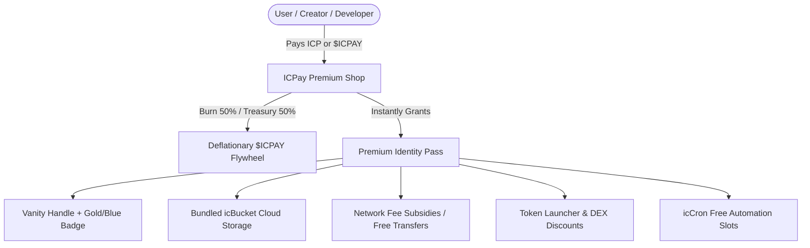

# ICPay Premium Business Model & $ICPAY Token Utility Research

**Date**: November 2026  
**Document**: `docs/research/premium-business-model-icpay-tokenomics.md`  
**Status**: Proposal & Strategy Analysis  
**Primary Sources Analyzed**:
- `backend/src/validators/UsernameValidator.mo`
- `backend/src/services/UsernameSaleService.mo`
- `backend/src/config/Config.mo`
- `frontend/lib/profile/username.ts`
- `frontend/lib/verified/premiumTick.ts`
- `frontend/lib/bucket/pricing.ts`
- `backend/rust/iccron/`
- Primary web3 comparables: Telegram Fragment (TON), ENS (.eth), Solana SNS (.sol), X/Twitter Premium.

---

## 1. Executive Summary & Problem Diagnosis

### The Current State
ICPay currently implements a static length-based username pricing model:
- **1–3 characters ("Ultra Premium")**: 10 ICP (~$50–$100 depending on market) + Gold Verified Badge.
- **4 characters ("Premium")**: 5 ICP (~$25–$50) + Blue Verified Badge.
- **5 characters ("Standard")**: 2 ICP (or free first claim if $\ge 5$ chars).
- **6–8 characters ("Basic")**: 1 ICP (or free first claim).

### Why the Current Model Underperforms (Conversion Bottleneck)
1. **Low Value-to-Price Ratio**: A buyer paying 10 ICP currently receives:
   - The handle string itself.
   - A static badge SVG (Gold/Blue tick).
   - Slightly higher sorting rank in unauthenticated `/verse` search.
   - Basic transaction history analytics & CSV export.
   *For ordinary users and creators, this offers virtually zero ongoing financial or operational utility.*
2. **Zero Native Token ($ICPAY) Integration**:
   - $ICPAY exists as an ICRC-1 token (`5fsnk-rqaaa-aaaan-q6m4q-cai`) with active presale inventory (20,000 ICPAY per ICP) and ICPSwap DEX integration.
   - **Crucial flaw**: A user holding $ICPAY cannot use it inside ICPay. Handles cannot be bought with $ICPAY, holding $ICPAY does not grant fee discounts, and username sales burn zero $ICPAY.
3. **Siloed Ecosystem Value**:
   - ICPay has built **icBucket** (decentralized on-chain cloud storage with 1–100GB tiers), **icCron** (autonomous on-chain task scheduler), a **Token Launchpad** (5 ICP per launch), and **ICPVerse** (community messaging and tipping).
   - None of these are bundled into the premium handle purchase.

---

## 2. Competitive Benchmarks & Primary Learnings

| Platform | Pricing Model | Native Token Flywheel | Value Proposition / Perks |
|---|---|---|---|
| **Telegram Fragment** | Auction + fixed tiers in TON | Direct utility: only payable in $TON. Burns/locks $TON. | Collectible username, NFT ownership, anonymous phone numbers, channel revenue share. |
| **ENS (Ethereum)** | Annual rental fee ($5–$640/yr in ETH) | DAO governance token ($ENS). | Decentralized domain, subdomains, reverse resolution, IPFS website hosting. |
| **X / Twitter Premium** | Monthly / Annual SaaS ($8–$16/mo) | None (fiat). | Blue tick, 50% fewer ads, revenue sharing, Grok AI access, longer posts. |
| **Solana SNS** | One-time purchase in $FIDA / $SOL | Staking $FIDA reduces domain fees, burns token. | Subdomains, decentralized website, record mapping, wallet branding. |

### Key Takeaway for ICPay:
Web3 identity is no longer just a string mapping; it must be a **Pass to the Supercharged Ecosystem** that drives **deflationary utility to $ICPAY**.

---

## 3. The New ICPay Business Model: "Supercharged Identity Pass"

Instead of selling an empty name with an icon, each Premium Username purchase becomes an **All-in-One ICPay Pro Bundle**:

### Proposed Tier Architecture:

| Tier | Length | Price (ICP / $ICPAY) | Storage Perks (icBucket) | Wallet & Platform Perks | $ICPAY Tokenomics Impact |
|---|---|---|---|---|---|
| **Gold Ultra** | 1–3 chars | **10 ICP** or **160,000 ICPAY** *(20% token discount)* | **5 GB for 1 Year** on-chain decentralized storage (renewable) | • Gold Verified Badge & #1 search rank • 50% off Token Launcher (2.5 ICP) • Full Analytics & CSV Export | 50% of $ICPAY burned; 50% to cycle reserve |
| **Blue Premium** | 4 chars | **5 ICP** or **85,000 ICPAY** *(15% token discount)* | **1 GB for 1 Year** on-chain decentralized storage (renewable) | • Blue Verified Badge & high search rank • 25% off Token Launcher • Full Analytics & CSV Export | 50% of $ICPAY burned; 50% to cycle reserve |
| **Standard** | 5 chars | **2 ICP** or **35,000 ICPAY** *(12.5% token discount)* | **None (0 GB)** — storage add-on available | • Verified Identity Badge • Priority directory listing | 50% of $ICPAY burned |
| **Basic / Alias** | 6–8 chars | **1 ICP** or **18,000 ICPAY** (or 1st free) | **None (0 GB)** — strictly handle alias | • Unlimited alias forwarding to primary principal | 50% of $ICPAY burned |

> **Note on Cycle Economics & Server Load**:
> Storage perks are strictly time-bounded (12 months): 5 GB for Gold Ultra costs ~2.0 ICP/yr and 1 GB for Blue Premium costs ~0.4 ICP/yr in canister cycle burn, leaving overwhelming revenue margins on 10 ICP and 5 ICP purchases. Basic & alias handles receive 0 storage, eliminating any micro-burn leaks. Current premium users with handles $\le 4$ chars automatically qualify to claim their respective 5 GB or 1 GB 1-Year allowance without re-paying.

---

## 4. $ICPAY Token Utility Matrix

To turn $ICPAY into a high-demand token with genuine economic velocity:

1. **Dual Currency Payment with Discount**:
   - Buyers can pay in ICP or $ICPAY.
   - Paying in $ICPAY gives a **15%–20% discount**, encouraging users to buy $ICPAY on ICPSwap or presale.
2. **Deflationary Burn Mechanics**:
   - Every time a username is purchased with $ICPAY, **50% of the $ICPAY is burned** (transferred to the blackhole/minting address), decreasing total circulating supply.
   - The remaining 50% goes to the treasury for canister cycle maintenance.
3. **VIP Staking / Holding Tiers ("Hold-to-Earn Perks")**:
   - Even users who do not purchase 1–3 char names can unlock **Gold/Blue badges and storage perks** by holding $\ge 100,000$ $ICPAY in their ICPay custodial wallet!
   - This creates massive lock-up pressure, reducing selling volume on ICPSwap.
4. **icBucket & icCron Payment in $ICPAY**:
   - Storage renewals and cron task executions can be settled in $ICPAY at a preferential rate.

---

## 5. Technical Feasibility & Architecture Map

1. **Backend Canister (`icp_wallet_backend`)**:
   - `UsernameSaleService.mo`: Extend `purchase` to accept either ICP or $ICPAY ledger payment.
   - Treasury subaccount handles $ICPAY burns.
   - Link username tier to storage entitlement in `icp_blob_store`.
2. **Frontend UI (`frontend/components/profile/username-purchase-view.tsx`)**:
   - Introduce currency toggle: Pay with `ICP` or `ICPAY` (highlighting the discount).
   - Display the complete perk breakdown card:
     - Verified Badge (Gold/Blue)
     - Bundled On-Chain Storage (icBucket)
     - Free Transfer Allowance
     - Priority Search & Channel Badges
   - Show live ICP and ICPAY balances simultaneously.
