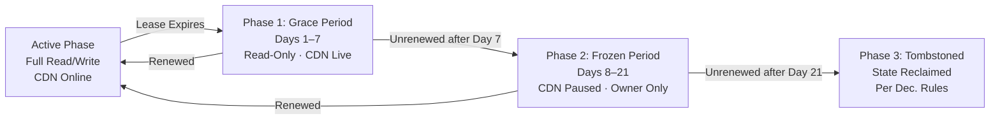

# icBucket Storage Policy & Operational Transparency Charter

> **Version**: 1.0  
> **Effective Date**: October 2026  
> **Canisters**: `icp_wallet_backend` (`6vbhm-nqaaa-aaaan-q6muq-cai`), `icp_blob_store` (`fly6t-piaaa-aaaan-q6oga-cai`), `icpay_notifier` (`2hvuh-xiaaa-aaaan-q6uua-cai`)  
> **Official Gateway & CDN**: `https://cdn.icpay.app` | `https://cloud.icpay.app`  

---

## 1. Executive Summary & Purpose

Traditional cloud storage providers (such as AWS S3, Google Cloud Storage, and Microsoft Azure Blob Storage) operate under asymmetric terms of service. Accounts can be terminated, frozen, or rate-limited through opaque heuristic flags or payment processor declines, immediately severing public file access via `403 Forbidden` errors and holding enterprise data hostage behind automated support tickets. Furthermore, high-bandwidth applications suffer punitive data egress bandwidth charges (frequently \$0.08–\$0.09 per gigabyte).

**icBucket** is an on-chain, decentralized, S3-compatible object storage infrastructure hosted natively on the **Internet Computer Protocol (ICP)**. This charter establishes our binding transparency commitments, lifecycle rules, fee structures, and data sovereignty guarantees for developers, dApps, and enterprises.

---

## 2. Cryptographic Ownership & Anti-Deplatforming Guarantee

1. **Sovereignty via Internet Identity**:
   - Every bucket is cryptographically anchored to the bucket creator's Internet Identity principal.
   - Authentication relies solely on WebAuthn biometric passkeys (Face ID, Touch ID, YubiKey).
   - ICPay never stores seed phrases, private keys, `.pem` certificates, or passwords.
2. **Zero Centralized Kill-Switch**:
   - There is no centralized root administrator key capable of unilaterally deleting, corrupting, or seizing an active bucket's content.
   - Only the authenticated owner principal possesses the cryptographic capability to upload, modify, delete, configure public/private visibility, or generate scoped API credentials.
3. **Immutability of Object Paths**:
   - Once written into consensus-verified persistent stable memory, files cannot be tampered with or silently altered by intermediaries. File content hashes are verifiable directly on-chain.

---

## 3. Storage Lifecycle Policy

To preserve subnet cycle economics and prevent permanent abandoned state while ensuring applications never suffer catastrophic data loss from temporary subscription lapses, icBucket operates a transparent **3-Phase Storage Lifecycle**:



### Phase 1: 7-Day Read-Only Grace Period (Days 1–7)
- **Status**: `EXPIRED (Grace Period)`
- **File Access**: **100% Online**. Public CDN delivery (`https://cdn.icpay.app`) remains active. External users, live websites, dApps, and mobile apps continue reading and streaming assets without interruption.
- **Write Operations**: New file uploads, chunk streams, and deletions are paused.
- **Objective**: Prevents live web production outages if a developer or team misses an expiration date or renewal window.

### Phase 2: 14-Day Frozen Period (Days 8–21)
- **Status**: `FROZEN`
- **File Access**: Public CDN edge caching returns a polite status notice indicating the bucket is paused pending owner renewal.
- **Owner Restoration**: The authenticated owner can sign into `https://icpay.app/bucket`, inspect file manifests, and execute a renewal at any time during this period.
- **Data Safety**: All files remain 100% intact in stable storage without loss of fidelity.

### Phase 3: Tombstone & Space Reclamation (After Day 21)
- **Status**: `TOMBSTONED`
- **Action**: Buckets that remain unrenewed for 21 consecutive days past lease expiration are marked as abandoned and scheduled for automated state reclamation.
- **Notification**: Bucket owners registered with the notifier plane receive multiple alerts prior to this irreversible state.

---

## 4. Autonomous Lifecycle Notifier Plane

Lifecycle sweeps are governed autonomously on-chain by the `icpay_notifier` canister (`2hvuh-xiaaa-aaaan-q6uua-cai`) using native IC system timers—eliminating dependence on centralized human cron jobs:

1. **Bucket Creation Confirmation**:
   - Upon bucket creation with an alert email, a formal welcome receipt is dispatched detailing canister ID, capacity tier, and API instructions.
2. **Expiring Warning Alerts**:
   - When a bucket lease has **3 days or fewer remaining**, an automated notification is sent with full details and direct 1-click renewal links.
3. **Grace Period Warnings**:
   - Immediate notification is dispatched on Day 1 of entering the grace period.
4. **Consensus & Idempotency Safeguards**:
   - Every notification uses deterministic `Idempotency-Key` headers matching across all 13 subnet replicas. Resend API deduplicates outcalls to ensure exactly **one** email is delivered per stage.
   - A minimum 20-hour cooldown window is cryptographically enforced to guarantee zero duplicate alert spam.

---

## 5. Zero Egress Bandwidth Guarantee

| Parameter | AWS S3 Standard | Traditional Web3 / IPFS Pinning | icBucket (ICPay Cloud) |
|---|---|---|---|
| **Egress Bandwidth Fee** | **\$0.09 / GB** | Opaque or Gateway Billed | **\$0.00 / GB (Always Free)** |
| **API Request Fees (GET/PUT)** | \$0.005 / 1,000 requests | Variable | **\$0.00 Included in Lease** |
| **Edge CDN Delivery** | CloudFront billed extra | Third-party proxy | **Sub-50ms Global Edge CDN Included** |
| **Storage Allocation Model** | Monthly metered bill shock | Volatile token staking | **Predictable ICP Flat-Rate Lease** |

- Public media, images, dApp frontends, and binary assets cached through `https://cdn.icpay.app` incur **\$0.00** in outbound network transfer penalties, regardless of download volume.
- Developers are protected from malicious denial-of-wallet (DoW) traffic spikes or viral social media surges.

---

## 6. Access Control & Scoped API Credentials

1. **Public vs. Private Visibility**:
   - **Public Buckets**: Assets are readable globally at `https://cdn.icpay.app/cloud/{bucketName}/{filePath}`.
   - **Private Buckets**: Direct access requires authenticated query signatures or scoped API credentials.
2. **Scoped API Keys (`icp_cloud_*`)**:
   - Generated via biometric passkey in the web dashboard.
   - Support granular permission scoping: `read-only`, `write-only`, or `admin`.
   - Keys can be instantly revoked on-chain at any time with immediate effect.

---

## 7. Data Sharding & Physical Headroom Transparency

- Physical object payloads reside in independent Rust storage shards (`icp_blob_store`, `fly6t-piaaa-aaaan-q6oga-cai`) leveraging `ic-stable-structures`.
- **Canister Ceiling**: 400 GB per canister shard.
- **Sharding Runbook**: When a storage shard reaches 75% capacity (300 GB), the control plane automatically provisions Canister Shard #2, scaling horizontally past 40 TB.
- **Auditability**: Anyone can verify live cluster capacity, module hashes, and cycle reserves at any time using:
  ```bash
  npm run ci blob:audit
  ```

---

## 8. Unit Economics & Pricing Transparency

icBucket prices storage predictably in ICP with deep volume discounts:

| Tier | Capacity | Monthly Lease | Annual Lease (Includes 2 Months Free) |
|---|---|---|---|
| **Starter** | 5 GB | ~0.20 ICP / mo | ~2.00 ICP / yr |
| **Developer** | 25 GB | ~0.90 ICP / mo | ~9.00 ICP / yr |
| **Team** | 50 GB | ~1.65 ICP / mo | ~16.50 ICP / yr |
| **Pro** | 100 GB | ~3.00 ICP / mo | ~30.00 ICP / yr |
| **Business** | 250 GB | ~7.00 ICP / mo | ~70.00 ICP / yr |
| **Enterprise** | 500 GB | ~13.00 ICP / mo | ~130.00 ICP / yr |

- **Cycles High-Water Mark Transparency**: Stored canisters operate well above the IC 30-day freezing threshold (~60.9B cycles/day reserve).
- **Lease Extensions**: Renewing early adds remaining duration cumulatively without forfeiting unexpired days.

---

## 9. Contact & Inquiries

- **Official Website**: [https://icpay.app](https://icpay.app)  
- **Storage Portal**: [https://icpay.app/icbucket](https://icpay.app/icbucket)  
- **Developer Documentation**: [https://icpay.app/bucket/docs](https://icpay.app/bucket/docs)  
- **Support & Security Desk**: [contact@icpay.cloud](mailto:contact@icpay.cloud)  
- **Official Twitter / X**: [@IcpayOfficial](https://x.com/IcpayOfficial)  
- **Open SDK Source (GitLab)**: [gitlab.com/prasangapokharel/icbucket](https://gitlab.com/prasangapokharel/icbucket)  
